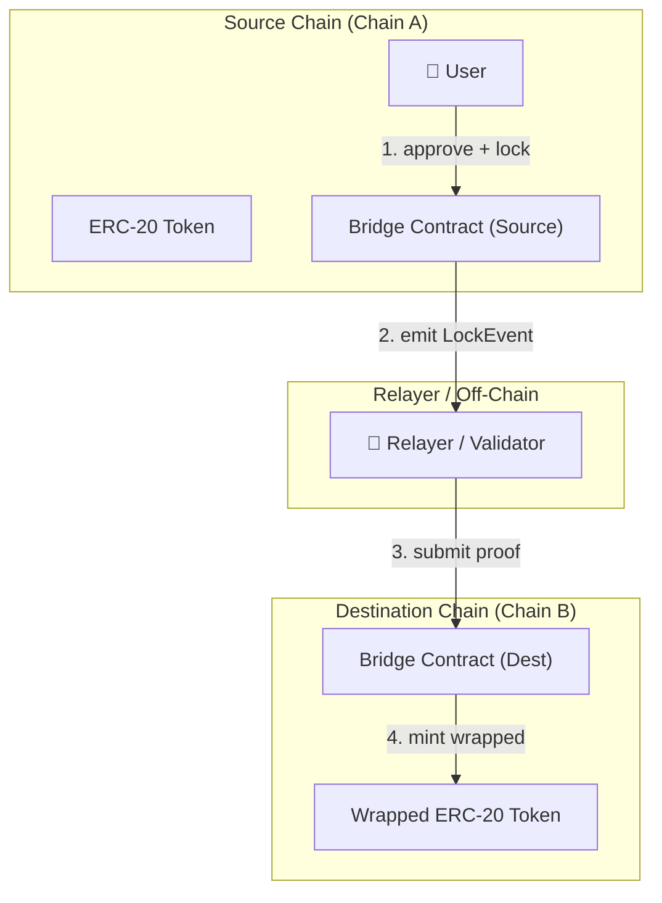
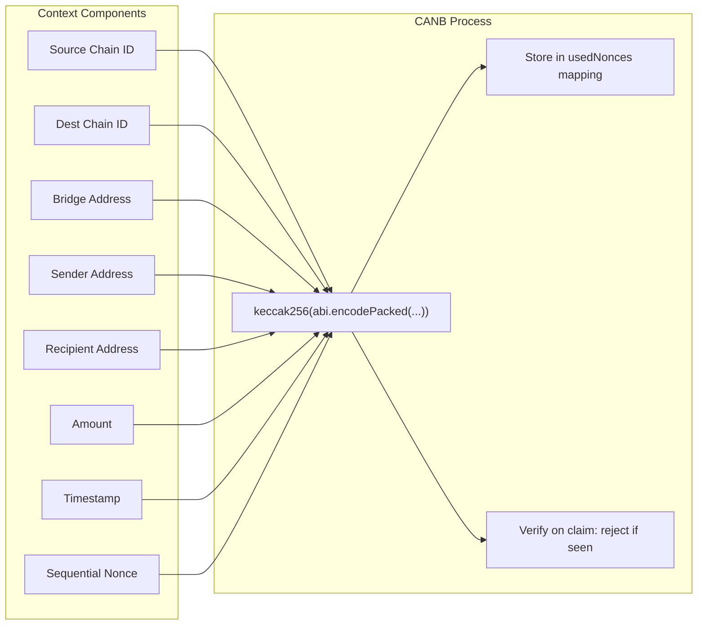

# 🔐 Thesis Implementation Plan
## Framework Mitigasi Replay Attack & Double Spending di Cross-Chain Bridge
### Baseline ERC-20 vs Context Aware Nonce Binding (CANB)

---

## 📐 Arsitektur Tingkat Tinggi



## 📦 Smart Contracts yang Perlu Dibuat

### 1. ERC-20 Token ✅ (sudah ada: `MockTelU1.sol`)
Token standar sebagai objek yang di-bridge. Sudah selesai.

### 2. Wrapped ERC-20 Token (Destination Chain)
Token yang di-mint di chain tujuan sebagai representasi token yang di-lock di chain sumber.

| Fitur | Detail |
|-------|--------|
| Mint | Hanya bisa di-mint oleh Bridge Contract |
| Burn | Di-burn saat user ingin withdraw kembali ke source chain |
| 1:1 peg | Selalu 1:1 dengan token asli |

### 3. Baseline Bridge Contract (Tanpa CANB) ⚠️
Bridge sederhana **tanpa proteksi replay/double-spend yang kuat**. Ini dijadikan sebagai **kontrol/baseline** untuk perbandingan.

| Komponen | Detail |
|----------|--------|
| `lockTokens()` | Lock ERC-20 di source chain |
| `claimTokens()` | Claim wrapped token di dest chain via signature |
| Nonce | Simple sequential nonce (atau tanpa nonce) |
| Signature | ECDSA dari relayer/validator |
| **Vulnerability** | Rentan replay attack & double spending |

### 4. CANB Bridge Contract (Dengan Context Aware Nonce Binding) 🛡️
Bridge yang sama, tetapi diperkuat dengan mekanisme CANB.

| Komponen | Detail |
|----------|--------|
| `lockTokens()` | Lock ERC-20 + generate context-aware nonce |
| `claimTokens()` | Claim dengan validasi CANB |
| Context Nonce | Binding: `chainId + bridgeAddr + sender + recipient + amount + timestamp + seqNonce` |
| Replay Guard | Nonce hash disimpan di mapping, tidak bisa digunakan ulang |
| Cross-chain Guard | Chain ID dan bridge address ikut di-hash, mencegah cross-chain replay |

### 5. (Opsional) Mock Relayer Contract
Untuk simulasi relayer yang memvalidasi dan mengirim proof ke destination chain.

---

## 🧪 Skenario Testing yang Harus Dibuat

### Happy Path ✅
| Test | Deskripsi |
|------|-----------|
| `test_LockAndClaim` | User lock di chain A → claim di chain B berhasil |
| `test_ClaimAndWithdraw` | User burn wrapped → unlock di chain A berhasil |
| `test_MultipleTransfers` | Beberapa transfer berturut-turut berhasil |

### Replay Attack Scenarios 🔴
| Test | Deskripsi | Baseline | CANB |
|------|-----------|----------|------|
| `test_ReplayExactSameMessage` | Replay pesan claim yang sama persis | ❌ Berhasil (vuln) | ✅ Revert |
| `test_ReplayCrossChain` | Gunakan proof dari chain A di chain C | ❌ Berhasil (vuln) | ✅ Revert |
| `test_ReplayDifferentBridge` | Gunakan proof di bridge contract lain | ❌ Berhasil (vuln) | ✅ Revert |
| `test_ReplayOldNonce` | Gunakan nonce lama yang sudah dipakai | ❌/✅ | ✅ Revert |

### Double Spending Scenarios 🔴
| Test | Deskripsi | Baseline | CANB |
|------|-----------|----------|------|
| `test_DoubleClaimSameLock` | Claim 2x untuk 1 lock event | ❌ Berhasil (vuln) | ✅ Revert |
| `test_RaceConditionClaim` | 2 tx claim secara bersamaan | ❌ Kemungkinan vuln | ✅ Revert |
| `test_ClaimWithManipulatedAmount` | Ubah amount di proof | Tergantung | ✅ Revert |

### Gas & Performance Benchmarks ⛽
| Metrik | Deskripsi |
|--------|-----------|
| `lockTokens()` gas cost | Bandingkan gas Baseline vs CANB |
| `claimTokens()` gas cost | Bandingkan gas Baseline vs CANB |
| Nonce generation overhead | Extra cost dari context binding |
| Storage cost | Extra storage untuk nonce mapping |

---

## 📂 Struktur Project yang Diusulkan

```
ccBridge/
├── src/
│   ├── token/
│   │   ├── MockTelU1.sol              # ERC-20 token (source chain)
│   │   └── WrappedTelU1.sol           # Wrapped ERC-20 (dest chain)
│   │
│   ├── bridge/
│   │   ├── BaselineBridge.sol         # Bridge TANPA CANB (baseline)
│   │   └── CANBBridge.sol             # Bridge DENGAN CANB (proposed)
│   │
│   └── libraries/
│       └── CANBLib.sol                # Library untuk Context Aware Nonce Binding
│
├── test/
│   ├── BaselineBridge.t.sol           # Tests untuk baseline bridge
│   ├── CANBBridge.t.sol               # Tests untuk CANB bridge
│   ├── ReplayAttack.t.sol             # Simulasi replay attacks
│   ├── DoubleSpending.t.sol           # Simulasi double spending
│   └── GasBenchmark.t.sol            # Gas comparison benchmarks
│
├── script/
│   └── Deploy.s.sol                   # Deployment script
│
└── foundry.toml
```

---

## 🔑 Konsep Inti CANB (Context Aware Nonce Binding)



### Pseudocode CANB:

```solidity
// Saat LOCK di source chain:
bytes32 contextNonce = keccak256(abi.encodePacked(
    block.chainid,        // source chain ID
    destChainId,          // destination chain ID  
    address(this),        // bridge contract address
    msg.sender,           // sender
    recipient,            // recipient on dest chain
    amount,               // token amount
    block.timestamp,      // timestamp
    userNonce[msg.sender] // sequential nonce per user
));

// Saat CLAIM di destination chain:
require(!usedNonces[contextNonce], "Nonce already used");
usedNonces[contextNonce] = true;
// ... verify signature, mint tokens
```

---

## 📊 Metrik Perbandingan untuk Thesis

| Aspek | Baseline | CANB | Cara Ukur |
|-------|----------|------|-----------|
| **Replay Attack Resistance** | ❌ Rentan | ✅ Tahan | Jumlah test yang revert |
| **Double Spending Resistance** | ❌ Rentan | ✅ Tahan | Jumlah test yang revert |
| **Gas Cost (Lock)** | Lower | Slightly Higher | `forge test --gas-report` |
| **Gas Cost (Claim)** | Lower | Slightly Higher | `forge test --gas-report` |
| **Storage Overhead** | Minimal | +1 mapping per tx | Slot count |
| **Latency** | Sama | Sama | Block confirmation time |
| **Complexity** | Rendah | Sedang | Lines of code, cyclomatic complexity |

---

## 🛠️ Langkah Implementasi (Urutan)

### Phase 1: Foundation
- [x] Setup Foundry project
- [x] Buat ERC-20 token (`MockTelU1.sol`)
- [ ] Buat Wrapped ERC-20 token (`WrappedTelU1.sol`)

### Phase 2: Baseline Bridge
- [ ] Implementasi `BaselineBridge.sol` (lock/claim sederhana)
- [ ] Tulis test happy path untuk baseline
- [ ] **Sengaja** tunjukkan vulnerability (replay & double spend)

### Phase 3: CANB Implementation
- [ ] Implementasi `CANBLib.sol` (nonce generation library)
- [ ] Implementasi `CANBBridge.sol` (bridge dengan CANB)
- [ ] Tulis test happy path untuk CANB

### Phase 4: Attack Simulation & Comparison
- [ ] Tulis `ReplayAttack.t.sol` — jalankan di kedua bridge
- [ ] Tulis `DoubleSpending.t.sol` — jalankan di kedua bridge
- [ ] Tulis `GasBenchmark.t.sol` — bandingkan gas costs

### Phase 5: Analysis & Documentation
- [ ] Kumpulkan data gas dari `forge test --gas-report`
- [ ] Buat tabel perbandingan
- [ ] Tulis analysis untuk thesis

---

> [!IMPORTANT]
> **Kunci thesis ini adalah perbandingan yang jelas dan terukur.** Pastikan `BaselineBridge` benar-benar **vulnerable** (sebagai kontrol), sehingga perbedaan dengan CANB terlihat jelas secara kuantitatif lewat test results dan gas benchmarks.

> [!TIP]
> Gunakan `forge test --gas-report` untuk mendapatkan gas comparison otomatis. Foundry juga bisa fork mainnet testnet jika ingin test di environment yang lebih realistis.
