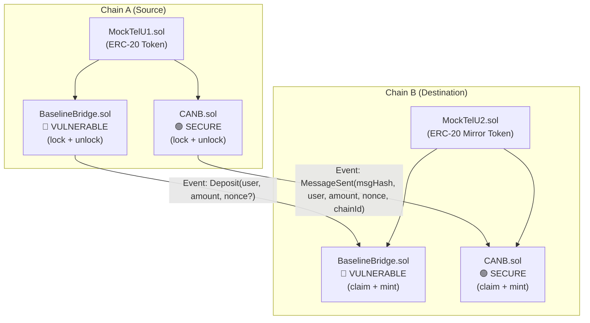
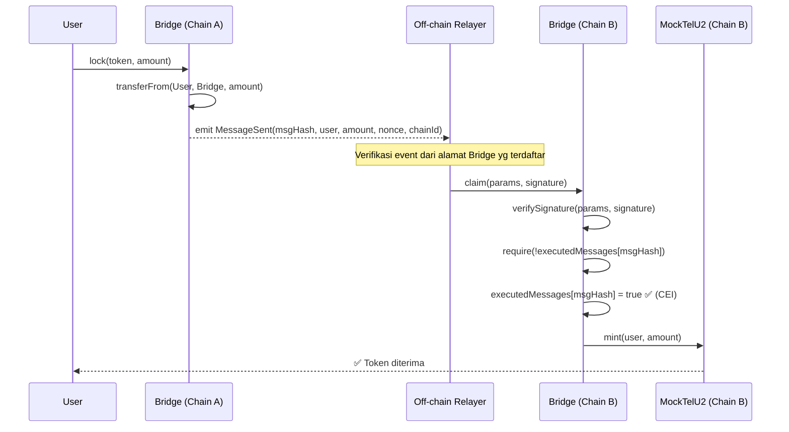

# ccBridge — Thesis Architecture Plan

## Overview

Tujuan penelitian adalah membuktikan secara **kuantitatif** bahwa implementasi CANB *(Cross-chain Adaptive Nonce Bridge)* lebih aman sekaligus efisien dibandingkan `BaselineBridge` yang vulnerable. Perbandingan dilakukan melalui **unit test exploitation results** dan **gas benchmarks** yang dijalankan sepenuhnya di Foundry.

> [!IMPORTANT]
> `BaselineBridge` harus **sengaja lemah** — ini adalah *control group* penelitian. Jangan perbaiki celahnya di sana. Semua perbaikan hanya ada di `CANB`.

---

## Layer 1 — Smart Contract Architecture

### Diagram Kontrak



---

### 1.1 `BaselineBridge.sol` — Kontrak Vulnerable (Control Group)

Kontrak ini sengaja dirancang dengan **4 kelemahan** yang akan dieksploitasi dalam test suite.

| # | Kelemahan | Fungsi yang Terdampak | Celah |
|---|-----------|----------------------|-------|
| V1 | **No Replay Protection** | `claim()` | Tidak ada `nonce` / `executedHashes` |
| V2 | **No ChainID Binding** | `claim()` | Signature valid di semua chain |
| V3 | **No Signature Verification** | `claim()` | Siapapun bisa claim |
| V4 | **Reentrancy on Unlock** | `unlock()` | Transfer sebelum state update |

**Struktur fungsi:**
```
BaselineBridge
├── lock(address token, uint256 amount)       ← deposit ke source chain
├── claim(address to, uint256 amount)         ← VULNERABLE: tidak verifikasi
├── unlock(address token, address to, uint256 amount) ← VULNERABLE: reentrancy
└── Events: Deposit(user, amount)             ← no nonce, no chainId
```

---

### 1.2 `CANB.sol` — Cross-chain Adaptive Nonce Bridge (Treatment Group)

Implementasi aman dengan mekanik perlindungan berlapis.

| # | Perlindungan | Mekanisme | Melindungi dari |
|---|--------------|-----------|-----------------|
| P1 | **Nonce Tracking** | `mapping(address => uint256) public nonces` | Replay Attack |
| P2 | **Message Hash Registry** | `mapping(bytes32 => bool) public executedMessages` | Cross-replay |
| P3 | **EIP-712 Signature Verification** | `ECDSA.recover` + `domainSeparator` | Signature Forgery |
| P4 | **ChainID Binding** | `block.chainid` dalam `domainSeparator` | Cross-chain Replay |
| P5 | **CEI Pattern** | State update sebelum transfer | Reentrancy |
| P6 | **Role-based Validator** | `mapping(address => bool) public validators` | Rogue Relayer |

**Struktur fungsi:**
```
CANB
├── lock(address token, uint256 amount)                      ← emit MessageSent dgn hash
├── claim(ClaimParams calldata params, bytes calldata sig)   ← full verification
├── unlock(address token, address to, uint256 amount, ...)  ← CEI pattern
├── addValidator(address) / removeValidator(address)         ← governance
└── Events: MessageSent(bytes32 msgHash, address user, uint256 amount, uint256 nonce, uint256 chainId)
```

---

### 1.3 Token Contracts

| File | Role | Chain |
|------|------|-------|
| `src/MockTelU1.sol` | Source token (sudah ada ✅) | Chain A |
| `src/MockTelU2.sol` | Mirror/wrapped token, owner = Bridge | Chain B |

`MockTelU2` sama persis dengan `MockTelU1` tetapi `owner` disetel ke alamat Bridge sehingga Bridge bisa memanggil `mint()` dan `burn()`.

---

## Layer 2 — Bridge System Design

### Alur Transaksi (Lock-and-Mint)



### Komponen Sistem

```
ccBridge/
├── src/
│   ├── MockTelU1.sol          ← ✅ Sudah ada
│   ├── MockTelU2.sol          ← [NEW] Mirror token
│   ├── BaselineBridge.sol     ← [NEW] Vulnerable bridge
│   ├── CANB.sol               ← [NEW] Secure bridge
│   └── interfaces/
│       ├── IBridge.sol        ← [NEW] Interface bersama
│       └── ITokenMintable.sol ← [NEW] Interface mint/burn
├── test/
│   ├── Counter.t.sol          ← ✅ Sudah ada (bisa diabaikan)
│   ├── baseline/
│   │   ├── ReplayAttack.t.sol        ← [NEW] Exploitasi V1
│   │   ├── CrossChainReplay.t.sol    ← [NEW] Exploitasi V2
│   │   ├── ForgeryAttack.t.sol       ← [NEW] Exploitasi V3
│   │   └── ReentrancyAttack.t.sol    ← [NEW] Exploitasi V4
│   ├── canb/
│   │   ├── ReplayProtection.t.sol    ← [NEW] Verifikasi perlindungan P1-P2
│   │   ├── SignatureVerify.t.sol     ← [NEW] Verifikasi perlindungan P3-P4
│   │   └── ReentrancyGuard.t.sol    ← [NEW] Verifikasi perlindungan P5
│   └── benchmark/
│       └── GasBenchmark.t.sol       ← [NEW] Perbandingan gas cost
├── script/
│   ├── Counter.s.sol          ← ✅ Sudah ada
│   ├── DeployBaseline.s.sol   ← [NEW]
│   └── DeployCANB.s.sol       ← [NEW]
└── src/attackers/
    ├── ReplayAttacker.sol     ← [NEW] Kontrak penyerang (helper test)
    └── ReentrancyAttacker.sol ← [NEW] Kontrak penyerang (helper test)
```

---

## Layer 3 — Attack Vectors (Test Catalogue)

### AV-1: Signature Replay Attack

**Target:** `BaselineBridge` — kelemahan **V1** dan **V3**

**Skema:**
1. `User` melakukan `lock(100 TELU)` → Bridge mencatat deposit
2. `Attacker` memanggil `claim(attacker_address, 100)` langsung tanpa signature
3. Karena `claim()` di Baseline tidak memverifikasi apapun, Attacker berhasil
4. `Attacker` memanggil `claim()` lagi → token dicetak lagi (replay)

**Expected Test Result:**

| Scenario | `BaselineBridge` | `CANB` |
|----------|-----------------|--------|
| Serangan pertama | ✅ Attacker BERHASIL | ❌ REVERT (invalid sig) |
| Replay ke-2 | ✅ Attacker BERHASIL | ❌ REVERT (msg hash used) |
| Token minted (seharusnya 100) | `∞` (unbounded) | `0` |

---

### AV-2: Cross-Chain Replay Attack

**Target:** `BaselineBridge` — kelemahan **V2**

**Skema:**
1. `User` melakukan bridge dari Chain A (ID: 1) ke Chain B (ID: 2)
2. Relayer mengeluarkan signature yang valid untuk Chain B
3. `Attacker` mengambil signature tersebut dan memutarnya di Chain C (ID: 3)
4. Jika tidak ada `chainId` di domain separator, signature tetap valid di Chain C

**Expected Test Result:**

| Scenario | `BaselineBridge` | `CANB` |
|----------|-----------------|--------|
| Claim di chain yang benar | ✅ | ✅ |
| Claim pakai sig chain lain | ✅ BERHASIL (VULNERABLE) | ❌ REVERT (chainId mismatch) |

---

### AV-3: Reentrancy Attack

**Target:** `BaselineBridge` — kelemahan **V4** pada fungsi `unlock()`

**Skema:**
1. `ReentrancyAttacker.sol` menyimpan token di Bridge, lalu meminta `unlock()`
2. Bridge mengirim ETH/token ke kontrak `ReentrancyAttacker`
3. Sebelum Bridge update state, fungsi `receive()` di kontrak Attacker memanggil `unlock()` lagi
4. Proses berulang sampai saldo Bridge habis

**Expected Test Result:**

| Metrik | `BaselineBridge` | `CANB` |
|--------|-----------------|--------|
| Jumlah `unlock()` terpanggil | `N` kali (drain habis) | `1` kali |
| Saldo Bridge setelah serangan | `0` (habis) | Normal |
| Status | 🔴 DRAINED | 🟢 AMAN |

---

### AV-4: Validator Impersonation (Khusus CANB Stress Test)

**Target:** Membuktikan CANB menolak validator tidak sah

**Skema:**
1. Penyerang membuat EOA baru (bukan validator terdaftar)
2. Penyerang menandatangani pesan claim yang valid secara struktur
3. `CANB.claim()` dipanggil dengan signature dari EOA palsu

**Expected Test Result:** `REVERT` dengan error `InvalidValidator`

---

## Metrics Perbandingan (untuk Bab Hasil & Pembahasan)

### A. Security Metrics (Pass/Fail)

| Attack Vector | BaselineBridge | CANB | Expected Delta |
|---------------|---------------|------|----------------|
| AV-1: Replay | 🔴 Fail | 🟢 Pass | +100% |
| AV-2: Cross-chain Replay | 🔴 Fail | 🟢 Pass | +100% |
| AV-3: Reentrancy | 🔴 Fail | 🟢 Pass | +100% |
| AV-4: Forgery | 🔴 Fail | 🟢 Pass | +100% |

### B. Gas Cost Metrics (Kuantitatif)

Diukur menggunakan Foundry `forge test --gas-report`:

| Fungsi | `BaselineBridge` (gas) | `CANB` (gas) | Overhead |
|--------|----------------------|-------------|---------|
| `lock()` | ~X | ~X+δ₁ | δ₁ (biaya emit hash) |
| `claim()` | ~Y | ~Y+δ₂ | δ₂ (biaya ECDSA + mapping write) |
| `unlock()` | ~Z | ~Z+δ₃ | δ₃ (biaya CEI + nonce update) |

> [!NOTE]
> Overhead gas **δ** yang kecil namun memberikan keamanan penuh adalah **kontribusi utama** CANB yang akan Anda argumentasikan di bab pembahasan.

### C. Throughput / Latency (Opsional)

Jika scope thesis mencakup off-chain relayer (misal pakai Node.js), bisa tambahkan:
- Waktu rata-rata dari `lock()` hingga `claim()` selesai
- Dapat diukur menggunakan Anvil (local testnet) + relayer script sederhana

---

## Urutan Implementasi

```
Phase 1 — Kontrak Dasar
  ├── [x] MockTelU1.sol (sudah ada)
  ├── [ ] MockTelU2.sol
  ├── [ ] interfaces/IBridge.sol
  └── [ ] interfaces/ITokenMintable.sol

Phase 2 — BaselineBridge (Vulnerable)
  ├── [ ] src/BaselineBridge.sol
  └── [ ] src/attackers/ReplayAttacker.sol
      └── [ ] src/attackers/ReentrancyAttacker.sol

Phase 3 — CANB (Secure)
  └── [ ] src/CANB.sol

Phase 4 — Test Suite
  ├── [ ] test/baseline/ (semua 4 attack tests)
  └── [ ] test/canb/ (semua protection tests)

Phase 5 — Benchmark
  └── [ ] test/benchmark/GasBenchmark.t.sol

Phase 6 — Deploy Scripts
  ├── [ ] script/DeployBaseline.s.sol
  └── [ ] script/DeployCANB.s.sol
```

---

## Open Questions

> [!IMPORTANT]
> **Q1 — Scope Relayer:** Apakah penelitian mencakup implementasi off-chain relayer (Node.js/Python) atau cukup smart contract saja dengan *simulated relayer* di test file?

> [!IMPORTANT]
> **Q2 — Nama CANB:** Apakah "CANB" sudah merupakan nama resmi dari thesis Anda? Ini diperlukan agar konsisten di semua file Solidity, dokumentasi, dan laporan.

> [!IMPORTANT]
> **Q3 — Dual Chain Simulation:** Apakah Bridge perlu disimulasikan di dua chain terpisah (menggunakan `vm.createFork()` di Foundry) atau cukup satu environment yang merepresentasikan kedua chain?

> [!NOTE]
> **Q4 — Tambahan Attack Vector:** Ada skema lain yang bisa ditambahkan seperti *Front-running Attack* atau *Flash Loan Manipulation*, jika Anda ingin memperluas cakupan penelitian.
