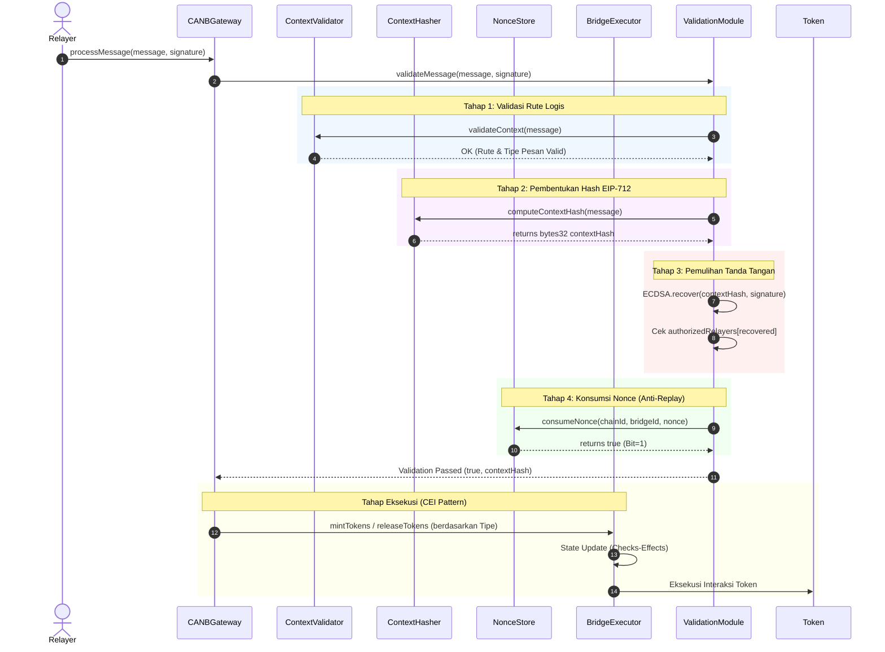

# Sequence Diagram: CANB Validation Pipeline

Dokumen ini memberikan representasi visual dari arsitektur *backbone* CANB, memperlihatkan bagaimana sebuah pesan dari pengguna luar divalidasi sebelum mencairkan atau mencetak token.

## Alur Eksekusi ValidationModule

Pipeline validasi CANB menerapkan pemisahan tugas (Separation of Concerns) yang ketat melalui beberapa sub-modul keamanan.

## Keunggulan Arsitektur Ini
1.  **Pemisahan Tugas:** Keamanan komputasi *hash*, verifikasi *signature*, dan konsumsi state terisolasi. Jika satu pola logika berubah, modul lainnya tetap terlindungi.
2.  **Anti-Reentrancy by Design:** CANB tidak pernah melakukan pemanggilan *external token* sebelum seluruh tahap validasi (sampai `consumeNonce`) selesai.
3.  **Transparansi Eksekusi:** Setiap langkah akan dibatalkan (*revert*) secara atomik jika ada satu tahap yang gagal (misalnya, alamat relayer tidak terdaftar, nonce diulang, dll).
