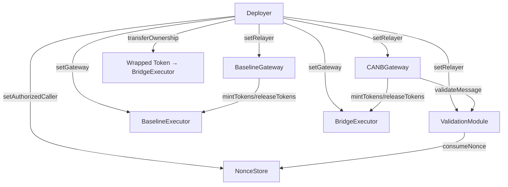

# 🚀 Deployment Script Documentation

**Penelitian:** *Mitigation Framework for Double-Spending and Replay Attacks in DeFi Cross-Chain Bridges*
**Script:** `script/DeployAll.s.sol`
**Framework:** Foundry (forge script)

---

## 1. Overview

`DeployAll.s.sol` adalah script deployment yang men-deploy **seluruh infrastruktur eksperimen** dalam satu transaksi broadcast. Script ini bersifat **idempotent** — setiap kali dijalankan akan menghasilkan instance baru yang independen.

### Contracts yang Di-deploy

| # | Contract | Role |
|:-:|:--|:--|
| 1 | MockERC20 (source) | Token sumber untuk lock |
| 2 | MockERC20 (wrapped) | Token wrapped untuk mint di CANB |
| 3 | BaselineGateway | Entry point baseline (vulnerable) |
| 4 | BaselineExecutor | Mint/release baseline |
| 5 | DomainSeparator | EIP-712 domain binding |
| 6 | ContextHasher | Context hash computation |
| 7 | NonceStore | Bitmap nonce management |
| 8 | ContextValidator | Route + type validation |
| 9 | ValidationModule | Pipeline orchestrator |
| 10 | BridgeExecutor | Guarded mint/release |
| 11 | CANBGateway | Entry point CANB (secure) |

---

## 2. Permission Wiring

Script secara otomatis mengatur permission berikut:



---

## 3. Environment Variables

| Variable | Default | Description |
|:--|:--|:--|
| `RELAYER_ADDRESS` | `msg.sender` (deployer) | Address relayer yang diotorisasi |
| `TOKEN_NAME` | `"Mock TelU Token"` | Nama token ERC-20 |
| `TOKEN_SYMBOL` | `"mTELU"` | Symbol token |
| `INITIAL_SUPPLY` | `1,000,000` | Supply awal (whole units) |

---

## 4. Usage

### 4.1 Deploy ke Local Fork (Dry-Run)

```bash
# Start Anvil fork
anvil --fork-url https://sepolia.base.org --chain-id 84532

# Deploy to local fork
forge script script/DeployAll.s.sol \
    --rpc-url http://localhost:8545 \
    --broadcast \
    -vvvv
```

### 4.2 Deploy ke Testnet

```bash
# Base Sepolia
forge script script/DeployAll.s.sol \
    --rpc-url https://sepolia.base.org \
    --broadcast \
    --private-key $DEPLOYER_KEY \
    --verify \
    -vvvv

# Lisk Sepolia
forge script script/DeployAll.s.sol \
    --rpc-url https://rpc.sepolia-api.lisk.com \
    --broadcast \
    --private-key $DEPLOYER_KEY \
    -vvvv

# Kaia Baobab
forge script script/DeployAll.s.sol \
    --rpc-url https://public-en-kairos.node.kaia.io \
    --broadcast \
    --private-key $DEPLOYER_KEY \
    -vvvv
```

### 4.3 Custom Relayer Address

```bash
RELAYER_ADDRESS=0x1234...abcd forge script script/DeployAll.s.sol \
    --rpc-url $RPC_URL \
    --broadcast \
    --private-key $DEPLOYER_KEY
```

---

## 5. Deployment Output

Script akan mencetak summary lengkap:

```
=== DEPLOYMENT SUMMARY ===
Chain ID: 84532
Relayer: 0x...

--- Baseline ---
Gateway: 0x...
Executor: 0x...

--- CANB ---
Gateway: 0x...
ValidationModule: 0x...
DomainSeparator: 0x...
ContextHasher: 0x...
NonceStore: 0x...
ContextValidator: 0x...
BridgeExecutor: 0x...

--- Tokens ---
Source Token: 0x...
Wrapped Token: 0x...
========================
```

---

## 6. Post-Deploy Checklist

- [ ] Semua 11 contracts deploy sukses
- [ ] Contract addresses dicatat di spreadsheet
- [ ] Baseline relayer terdaftar
- [ ] CANB relayer terdaftar di gateway DAN ValidationModule
- [ ] NonceStore authorized caller = ValidationModule
- [ ] BridgeExecutor gateway = CANBGateway
- [ ] Wrapped token ownership = BridgeExecutor
- [ ] Test transaksi legitimate berhasil
- [ ] Test replay di-reject (CANB) / berhasil (Baseline)
- [ ] Gas snapshot diambil

---

## 7. Security Notes

> [!WARNING]
> - Private key deployer harus disimpan di `.env` yang sudah ada di `.gitignore`
> - Jangan gunakan private key yang memiliki aset di mainnet
> - Verify chain ID (84532, 4202, 1001) sebelum broadcast
> - Hanya gunakan MockERC20, BUKAN token asli (USDC/IDRX)
