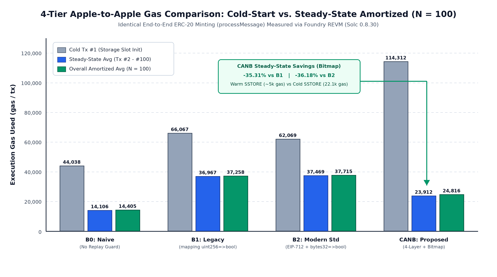

# ⛽ 4-Tier Apple-to-Apple Gas Benchmark Documentation (Stage E1 & E3)

**Penelitian:** *Mitigation Framework for Double-Spending and Replay Attacks in DeFi Cross-Chain Bridges*  
**Status:** Semester 3 — *Implementasi Proyek 2* (Terverifikasi Lokal, November 2026)  
**Tool:** Foundry `forge 1.7.1` (`Solc 0.8.30`, `via_ir = true`, `optimizer_runs = 200`)  
**Test File:** `test/integration/ComparisonBenchmark.t.sol`

---

## 1. Overview & *Ceteris Paribus* Design

Pengukuran gas ini mengevaluasi **Dependent Variable 3 (DV3 — Gas Overhead)** untuk menguji **Hipotesis H1c** (`< 20%` overhead vs. Legacy B1, serta *gas parity / net savings* vs. Modern Standard B2).

Berbeda dari pengukuran awal (`24,778` gas yang belum memanggil `mintTokens()`), benchmark 4-Tier ini menerapkan kondisi ***ceteris paribus* penuh**:
- Seluruh 4 tier (`B0`, `B1`, `B2`, `CANB`) menjalankan alur eksekusi ERC-20 *end-to-end* yang identik (`mintTokens` / `releaseTokens` / `recordDeposit`).
- Seluruh pesan di-signing terlebih dahulu (*pre-signed off-measurement*) sebelum blok `gasleft()` agar angka yang terekam adalah **pure EVM contract execution gas**.
- Pengukuran dibagi menjadi **Stage E1 (Cold-Start `nonce = 1`)** dan **Stage E3 (Steady-State Amortized Batch `N = 50` dan `N = 100`)** untuk menangkap karakteristik riil Bitmap `NonceStore` (256 nonce per slot `uint256`).

---

## 2. Empirical 4-Tier Benchmark Results (`processMessage(MINT)`)

| Architecture Tier | Cold Tx #1 | Steady-State Avg (`tx #2..#100`) | Overall Avg (`N = 50`) | Overall Avg (`N = 100`) |
| :--- | ---: | ---: | ---: | ---: |
| **B0** Naive (`BaselineGateway`, no guard) | 44,038 gas | 14,106 gas | 14,696 gas | 14,405 gas |
| **B1** Legacy (`ConventionalGateway`, `uint256 => bool`) | 66,067 gas | 36,967 gas | 37,549 gas | 37,258 gas |
| **B2** Modern Std (`ModernStandardGateway`, EIP-712 + `bytes32 => bool`) | 62,069 gas | 37,469 gas | 37,961 gas | 37,715 gas |
| **CANB** Proposed (`CANBGateway`, 4-Layer + Bitmap `NonceStore`) | 114,312 gas | **23,912 gas** | **25,720 gas** | **24,816 gas** |
| **$\Delta$ CANB vs. B1 (%)** | +73.02% | **-35.31%** | **-31.50%** | **-33.39%** |
| **$\Delta$ CANB vs. B2 (%)** | +84.17% | **-36.18%** | **-32.24%** | **-34.20%** |



### Interpretasi Teknis (Mengapa CANB Lebih Hemat di Steady-State?)
1. **Cold-Start (`nonce = 1`, 114,312 gas):** Pada transaksi pertama dari setiap blok 256 nonce, CANB menginisialisasi slot bitmap baru (`_bitmaps[chainId][bridgeId][0]`) dan `nextExpectedNonce` (masing-masing *cold SSTORE* `22,100` gas) ditambah panggilan lintas-modul 4-layer.
2. **Steady-State (`tx #2..#256`, 23,912 gas/tx):** Mulai transaksi ke-2 hingga ke-256, `B1` (`mapping(uint256 => bool)`) dan `B2` (`mapping(bytes32 => bool)`) **tetap harus membayar `22,100` gas *cold SSTORE* di setiap pesan baru**. Sebaliknya, **Bitmap `NonceStore`** pada CANB hanya memodifikasi bit pada slot yang sudah *non-zero* (*warm SSTORE* `~2,900–5,000` gas), menghemat `~17,000` gas per transaksi pada lapisan storage.
3. **Hasil terhadap H1c:** CANB tidak hanya memenuhi ambang `< 20%`, tetapi mencatat **penghematan bersih `-35.31%` vs B1** dan **`-36.18%` vs B2** di *steady-state*.

---

## 3. Raw Foundry Gas Snapshot (`.gas-snapshot-4tier`)

```text
ComparisonBenchmarkTest:test_Baseline_LockAssets() (gas: 83842)
ComparisonBenchmarkTest:test_B1_Conventional_LockAssets() (gas: 83963)
ComparisonBenchmarkTest:test_B2_ModernStandard_LockAssets() (gas: 106747)
ComparisonBenchmarkTest:test_CANB_LockAssets() (gas: 107169)
ComparisonBenchmarkTest:test_Baseline_ProcessMessage() (gas: 54228)
ComparisonBenchmarkTest:test_B1_Conventional_ProcessMessage() (gas: 77067)
ComparisonBenchmarkTest:test_B2_ModernStandard_ProcessMessage() (gas: 78702)
ComparisonBenchmarkTest:test_CANB_ProcessMessage() (gas: 137130)
ComparisonBenchmarkTest:test_E3_AmortizedBatch_N50() (gas: 6790854)
ComparisonBenchmarkTest:test_E3_AmortizedBatch_N100() (gas: 13593425)
```

---

## 4. Local Foundry (REVM) vs. Multi-Testnet Equivalence

| Dimensi Evaluasi | Foundry Lokal (REVM) | Multi-Testnet (Base, Lisk, Kaia) | Implikasi Ilmiah |
| :--- | :--- | :--- | :--- |
| **Security Blocking (DV1) & $\Delta\text{Assets}=0$ (DV2)** | Deterministik (100% identik) | Eksekusi EVM identik | Revert kriptografi invariant di seluruh jaringan EVM. |
| **Contract Execution Gas (DV3)** | Opcode & `SSTORE` eksak | Execution gas + `21,000` base tx + calldata | `gasleft()` lokal mengisolasi biaya validasi murni. |
| **Economic & L1 Data Fee** | Tidak dimodelkan (`gasPrice = 0`) | `baseFee` + OP-Stack L1 DA fee | Menangkap perbedaan biaya ekonomi L2 Rollup vs L1 BFT. |
| **Latency & Finality (DV4)** | Instan (`0 ms`) | Block time & finality nyata (~1–2s+) | Target utama tahap multi-testnet & ANOVA lintas-chain. |

---

## 5. Cara Menjalankan Ulang Benchmark

```bash
cd ccBridge
forge test --match-contract ComparisonBenchmarkTest -vv
forge snapshot --match-contract ComparisonBenchmarkTest --snap .gas-snapshot-4tier
```
