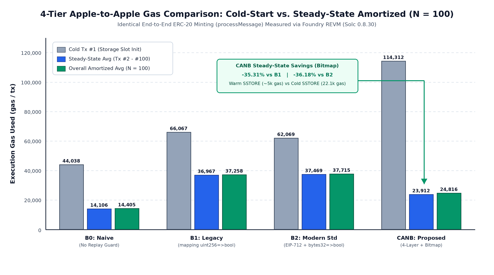

# Executive Summary (Ringkasan Eksekutif)

> **Status:** Semester 3 — *Implementasi Proyek 2* (**70% Overall Completion**, November 2026)  
> **Verifikasi Lokal:** **114/114 Passing Tests** (`Solc 0.8.30`, Foundry `forge 1.7.1`)

## Latar Belakang Masalah
Pertumbuhan ekosistem blockchain memicu tingginya adopsi *Cross-Chain Bridge* untuk mentransfer likuiditas antar-jaringan. Dari September 2021 hingga Juli 2023, eksploitasi bridge menghasilkan kerugian terkonfirmasi sebesar **$2.83 miliar** di 35+ insiden — mewakili 72% dari total kerugian eksploitasi DeFi [Zhang et al., RAID 2024]. Akar masalah utama adalah **State Isolation**: EVM pada satu chain tidak dapat secara native memverifikasi state, konteks, atau riwayat eksekusi chain lain.

### Posisi Terhadap Standar Industri Modern (2024–2026)
Ekosistem interoperabilitas produksi saat ini telah berkembang menuju protokol *Generalized Message Passing* (GMP) modular (**LayerZero V2**, **Wormhole**, **Hyperlane**, **Chainlink CCIP**), standar *native burn-and-mint* (**Circle CCTP**, **SuperchainERC20**), serta jaringan *intent-based solver* (**Across/ERC-7683**, **Uniswap Permit2**). Meski GMP modern sudah memakai *domain separation*, sebagian besar masih mengandalkan `mapping(bytes32 => bool)` yang membayar **22,100 gas *cold SSTORE* di setiap pesan baru**, dan belum memaksakan *temporal freshness* di level gateway. **CANB** diposisikan sebagai *lightweight, gas-efficient, 4-layer preventive verification framework* untuk *custom/enterprise/appchain EVM gateways* — dan komponen bitmap/freshness-nya kompatibel untuk diadaptasi sebagai *custom Hyperlane ISM* atau *ERC-7683 intent replay guard*.

## Solusi: CANB Framework (4-Layer Architecture)
Tesis ini memperkenalkan **Context-Aware Nonce Binding (CANB)** — 15 kontrak Solidity modular dengan 4 pilar pengamanan:
1. **ContextHasher & DomainSeparator (EIP-712):** Mengikat ketat setiap tanda tangan ke `(chainId, contractAddr, bridgeId)` sesuai EIP-712 dan NIST SP 800-185.
2. **ContextValidator:** Memverifikasi parameter rute asal-tujuan dan tipe pesan inbound (`MINT`/`RELEASE`) secara eksplisit.
3. **NonceStore (Bitmap + Time-Bounded):** Penyimpanan nonce bitmap (256 nonce per slot `uint256`) dengan batasan waktu `block.timestamp <= C.timestamp + T` untuk memblokir *same-context replay* dan *sleeping replay* (**AV-1-1**).
4. **BridgeExecutor (Strict CEI Pattern):** Pemisahan eksekutor token dengan *Checks-Effects-Interactions* agar menjaga invarian $\Delta\text{Assets} = 0$.

## Hasil Evaluasi Empiris 4-Tier (`B0` vs `B1` vs `B2` vs `CANB`)

Untuk menghindari *strawman bias* dan memastikan perbandingan *ceteris paribus* (seluruh tier menjalankan eksekusi ERC-20 *mint/release* yang identik), CANB diuji terhadap 3 tier baseline di Foundry (`114/114 tests passing`):

| Vektor Serangan / Invarian | B0 (Naive) | B1 (Legacy `uint256=>bool`) | B2 (Modern EIP-712 `bytes32=>bool`) | CANB (Proposed) |
| :--- | :---: | :---: | :---: | :---: |
| **AV-1: Same-Context Replay** | ❌ Jebol | ✅ Ditolak | ✅ Ditolak | ✅ **Ditolak** |
| **AV-1-1: Sleeping Replay ($+2\text{h} > T$)** | ❌ Jebol | ❌ Jebol | ❌ Jebol | ✅ **Ditolak (`NonceExpired`)** |
| **AV-2: Cross-Chain Replay** | ❌ Jebol | ❌ Jebol | ✅ Ditolak | ✅ **Ditolak** |
| **AV-2-1: Cross-Bridge Replay** | ❌ Jebol | ❌ Jebol | ✅ Ditolak | ✅ **Ditolak** |
| **AV-3: Reentrancy / CEI** | ❌ Rentan | ⚠️ Parsial | ✅ Aman (CEI) | ✅ **Aman (Strict CEI)** |
| **AV-4: Message Type Confusion** | ❌ Jebol | ❌ Jebol | ❌ Jebol | ✅ **Ditolak (`InvalidMessageType`)** |
| **AV-5: Out-of-Order Nonce** | ❌ Jebol | ❌ Jebol | ❌ Jebol | ✅ **Ditolak (`NonceOutOfOrder`)** |
| **DV2: Asset Conservation ($\Delta\text{Assets}=0$)** | ❌ Dilanggar | ❌ Dilanggar | ⚠️ Kondisional | ✅ **Terjaga ($\Delta = 0$)** |

### Efisiensi Biaya Gas (Stage E3 Amortized Steady-State, $N = 100$)
Di luar ekspektasi awal hipotesis H1c (`< 20%` overhead), penyimpanan Bitmap pada CANB justru menghasilkan **penghematan gas bersih (*net gas savings*)** dibanding B1 maupun B2:
- **Steady-State Avg (Tx #2–#100):** CANB **23,912 gas/tx** — **35.31% lebih hemat dari B1** (`36,967 gas`) dan **36.18% lebih hemat dari B2** (`37,469 gas`).
- **Overall Amortized Avg ($N = 100$, termasuk Cold Tx #1):** CANB **24,816 gas/tx** — **33.39% lebih hemat dari B1** dan **34.20% lebih hemat dari B2**.

## Langkah Selanjutnya (Sisa 30% Menuju Sidang)
1. **Multi-Testnet Deployment & Latency (DV4):** Deploy ke Base Sepolia, Lisk Sepolia, dan Kaia Kairos (Phases E1–E3).
2. **Evaluasi Statistik:** Binomial Test + Clopper-Pearson 95% CI (H1a), One-Sample $t$-test (H1c), dan One-Way ANOVA + Tukey HSD lintas-chain.
3. **Finalisasi Naskah Bab 4–5 & Sidang Tesis** (Jan–Feb 2027).
