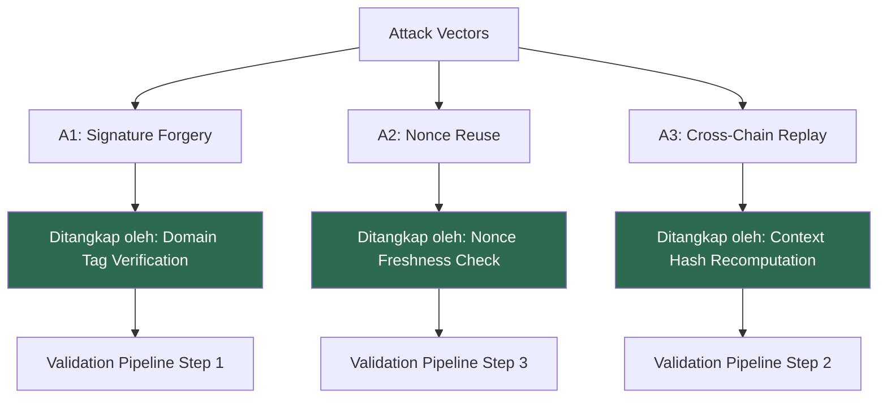

# 📋 Progress Minggu 3 — Desain Attack Scheme

**Penelitian:** *Mitigation Framework for Double-Spending and Replay Attacks in DeFi Cross-Chain Bridges*
**Periode:** Minggu ke-3 pasca Seminar Proposal
**Status:** ✅ Selesai

---

## 1. Tujuan Minggu Ini

Merancang **attack scheme** komprehensif yang akan digunakan sebagai skenario adversarial dalam fase eksperimen (Stage B2). Attack scheme ini harus mereplikasi pola serangan *realistis* berdasarkan literatur dan insiden historis, bukan serangan sintetis.

---

## 2. Taksonomi Serangan Cross-Chain Bridge

### 2.1 Klasifikasi Berdasarkan Zhang et al. (2024) — A11 Taxonomy

Zhang et al. mengklasifikasikan 35+ exploit ke dalam kategori:

| Kategori A11 | Deskripsi | Contoh Insiden | Relevansi CANB |
| :--- | :--- | :--- | :---: |
| **A1: Signature Forgery** | Memalsukan tanda tangan validator/guardian | Wormhole ($325M) | ✅ Tinggi |
| **A2: Nonce Reuse** | Menggunakan nonce yang sudah consumed | Multichain ($126M) | ✅ Tinggi |
| **A3: Cross-Chain Replay** | Replay transaksi valid dari chain lain | Ronin ($625M) | ✅ Tinggi |
| **A4: Validator Compromise** | Kompromi kunci privat validator | Ronin, Harmony | ⚠️ Parsial |
| **A5: Logic Bug** | Cacat logika dalam smart contract | Nomad ($190M) | ⚠️ Parsial |
| **A6: Oracle Manipulation** | Manipulasi price feed | Berbagai DeFi | ❌ Out of scope |

> [!IMPORTANT]
> Fokus CANB adalah **A1, A2, A3** — serangan yang bisa dimitigasi melalui domain separation dan nonce binding kriptografis. A4 dan A5 dimitigasi parsial oleh context validation.

### 2.2 Attack Vector Mapping ke CANB Validation Pipeline



---

## 3. Desain Skenario Serangan

### 3.1 Attack Scheme 1: Same-Context Replay (Double-Spending)

**Deskripsi:** Attacker menangkap transaksi `processMessage()` yang berhasil, lalu mengirimkan transaksi identik ke contract yang sama di chain yang sama.

**Prosedur:**
```
1. Alice melakukan lockAssets(100 USDC, Chain A → Chain B)
2. Relayer mengirim processMessage() di Chain B → Alice terima 100 wrapped USDC
3. Attacker mengirim processMessage() yang SAMA → Coba mint 100 wrapped USDC lagi
```

**Expected Behavior:**
| Bridge Type | Result | Alasan |
| :--- | :--- | :--- |
| Baseline | ✅ Mint berhasil (double-spend) | Tidak ada nonce uniqueness check |
| CANB | ❌ Revert: `NonceAlreadyUsed` | NonceStore mendeteksi nonce consumed |

**Variasi:**
- **SC-R1:** Replay setelah 1 block confirmation
- **SC-R2:** Replay setelah 100 block confirmations (delayed replay)
- **SC-R3:** Replay dengan modified gas price (front-running attempt)

### 3.2 Attack Scheme 2: Cross-Context Replay

**Deskripsi:** Attacker menangkap transaksi valid dari Chain A, lalu me-replay signature tersebut di Chain B yang menjalankan contract bridge yang sama.

**Prosedur:**
```
1. Alice lockAssets(100 USDC, Chain A → Chain B) — berhasil di Chain B
2. Attacker mengambil signature dari tx tersebut
3. Attacker mengirim processMessage() dengan signature SAMA di Chain C
4. Attacker mencoba mint 100 wrapped USDC di Chain C (tanpa ada lock di Chain A→C)
```

**Expected Behavior:**
| Bridge Type | Result | Alasan |
| :--- | :--- | :--- |
| Baseline | ✅ Mint berhasil (unauthorized) | Tidak ada domain separation — signature valid di chain manapun |
| CANB | ❌ Revert: `InvalidDomainTag` | EIP-712 domain separator mengandung chainId → signature HANYA valid di chain yang dituju |

**Variasi:**
- **CC-R1:** Replay Base → Lisk (L2 → sidechain)
- **CC-R2:** Replay Base → Kaia (L2 → L1)
- **CC-R3:** Replay Lisk → Kaia (sidechain → L1)

### 3.3 Attack Scheme 3: Cross-Bridge Replay

**Deskripsi:** Attacker menggunakan signature dari Bridge Instance X di Bridge Instance Y (di chain yang sama).

**Prosedur:**
```
1. Bridge X dan Bridge Y deploy di chain yang sama
2. Alice menggunakan Bridge X — lock 100 USDC
3. Attacker mengambil signature dan replay di Bridge Y
4. Attacker mencoba mint di Bridge Y tanpa ada lock
```

**Expected Behavior:**
| Bridge Type | Result | Alasan |
| :--- | :--- | :--- |
| Baseline | ✅ Mint berhasil | Tidak ada bridgeID/contractAddr binding |
| CANB | ❌ Revert: `InvalidContextHash` | Context hash mengandung `contractAddr` → unik per bridge instance |

### 3.4 Attack Scheme 4: Message Type Confusion

**Deskripsi:** Attacker mengirim message dengan `messageType` yang salah — misalnya mengirim lock-mint message ke endpoint burn-release.

**Prosedur:**
```
1. Alice lockAssets → menghasilkan message dengan type LOCK_MINT
2. Attacker memodifikasi messageType menjadi BURN_RELEASE
3. Attacker mengirim ke releaseAssets() endpoint
4. Tujuan: release aset yang sudah di-lock tanpa burn
```

**Expected Behavior:**
| Bridge Type | Result | Alasan |
| :--- | :--- | :--- |
| Baseline | ⚠️ Depends on impl | Mungkin berhasil jika tipe tidak dicek |
| CANB | ❌ Revert: `InvalidMessageType` | Context hash mengandung `messageType` |

### 3.5 Attack Scheme 5: Nonce Ordering Attack

**Deskripsi:** Attacker mencoba mengirim transaksi dengan nonce out-of-order atau nonce dari future.

**Prosedur:**
```
1. Current nonce = 5
2. Attacker mengirim message dengan nonce = 3 (past)
3. Attacker mengirim message dengan nonce = 100 (far future)
```

**Expected Behavior:**
| Bridge Type | Result | Alasan |
| :--- | :--- | :--- |
| Baseline | ✅ Diterima | Nonce tidak divalidasi ordering-nya |
| CANB | ❌ Revert | NonceStore strict ordering + freshness check |

---

## 4. Attack Execution Matrix

### 4.1 Test Matrix per Testnet

Setiap attack scheme dieksekusi di 3 testnet:

| Attack | Base Sepolia | Lisk Sepolia | Kaia Baobab | Total Tests |
| :--- | :---: | :---: | :---: | :---: |
| SC-R1/R2/R3 | 3 | 3 | 3 | 9 |
| CC-R1/R2/R3 | 3 | 3 | 3 | 9 |
| Cross-Bridge | 2 | 2 | 2 | 6 |
| Type Confusion | 2 | 2 | 2 | 6 |
| Nonce Ordering | 2 | 2 | 2 | 6 |
| **Total** | **12** | **12** | **12** | **36** |

### 4.2 Metrics Collection per Attack

Setiap attack menghasilkan data:

```
{
  "attackId": "CC-R1-BASE-001",
  "attackType": "cross_context_replay",
  "sourceChain": "base_sepolia",
  "targetChain": "lisk_sepolia",
  "bridgeType": "baseline | canb",
  "txHash": "0x...",
  "gasUsed": 85432,
  "latencyMs": 2340,
  "result": "success | revert",
  "revertReason": "InvalidDomainTag",
  "timestamp": 1714000000,
  "blockNumber": 12345678
}
```

---

## 5. Formal Attack Model

### 5.1 Threat Model

**Attacker Capabilities:**
- Dapat mengobservasi semua transaksi on-chain (public mempool/block explorer)
- Dapat mengirim transaksi ke chain manapun
- Dapat memodifikasi parameter non-signature (gas, nonce ordering)
- **TIDAK** memiliki private key relayer/validator

**Security Assumptions:**
- ECDSA signature scheme tidak broken
- Keccak-256 collision-resistant
- RPC endpoints reliable dan tidak compromised

### 5.2 Formalisasi Domain Separator (EIP-712)

```
domainSeparator = keccak256(
    abi.encode(
        keccak256("EIP712Domain(string name,string version,uint256 chainId,address verifyingContract,bytes32 bridgeId)"),
        keccak256("CANBBridge"),
        keccak256("1"),
        block.chainid,
        address(this),
        BRIDGE_IDENTIFIER
    )
)
```

### 5.3 Context Hash Computation

```
contextHash = keccak256(
    abi.encodePacked(
        domainSeparator,
        keccak256(abi.encode(
            MESSAGE_TYPEHASH,
            sourceChainId,
            destinationChainId,
            sender,
            recipient,
            token,
            amount,
            nonce,
            messageType
        ))
    )
)
```

> [!NOTE]
> Setiap field dalam context hash berfungsi sebagai **binding point** — mengubah salah satu field menghasilkan hash yang berbeda, sehingga signature menjadi invalid.

---

## 6. Deliverables Minggu 3

- [x] Taksonomi serangan berdasarkan Zhang et al. A11
- [x] 5 attack scheme detail dengan prosedur dan expected behavior
- [x] Attack execution matrix (36 total test cases across 3 testnets)
- [x] Formal threat model dan attacker capability definition
- [x] Formalisasi domain separator dan context hash computation (EIP-712)
- [x] Metrics collection schema (JSON format)

### Transisi ke Minggu 4

Attack scheme sudah lengkap. Minggu berikutnya fokus pada **desain arsitektur smart contract** yang diinformasikan oleh attack scheme — yaitu memastikan setiap komponen contract secara spesifik menangani attack vector yang sudah diidentifikasi.
