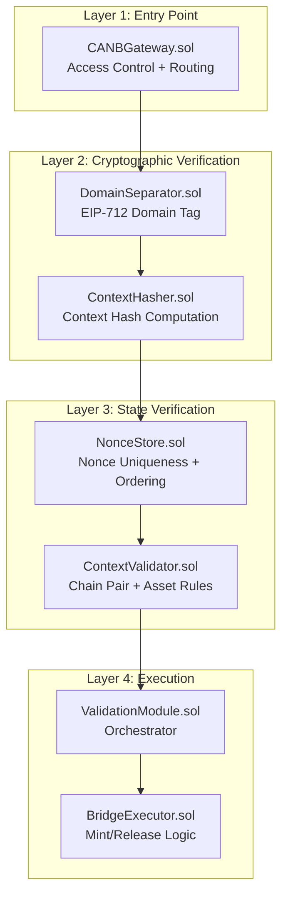

# 📋 Progress Minggu 4 — Desain Arsitektur Smart Contract Hasil dari Attack Scheme

**Penelitian:** *Mitigation Framework for Double-Spending and Replay Attacks in DeFi Cross-Chain Bridges*
**Periode:** Minggu ke-4 pasca Seminar Proposal
**Status:** ✅ Selesai

---

## 1. Tujuan Minggu Ini

Mendesain arsitektur smart contract CANB yang secara **langsung merespons setiap attack vector** yang diidentifikasi di Minggu 3. Setiap komponen contract harus memiliki justifikasi jelas — *"Komponen X ada karena menangkis Attack Y."*

---

## 2. Mapping Attack Scheme → Contract Component

### 2.1 Traceability Matrix

| Attack Scheme (W3) | Vulnerability Exploited | Contract Component | Validation Check |
| :--- | :--- | :--- | :--- |
| SC-R (Same-Context Replay) | Nonce tidak unique | **NonceStore.sol** | `isNonceUsed(chainId, nonce)` |
| CC-R (Cross-Context Replay) | Tidak ada domain separation | **DomainSeparator.sol** | EIP-712 domain tag binding |
| Cross-Bridge Replay | Tidak ada bridgeId binding | **ContextHasher.sol** | `contractAddr` dalam context hash |
| Message Type Confusion | Tidak ada messageType check | **ValidationModule.sol** | `messageType` dalam typed hash |
| Nonce Ordering Attack | Tidak ada ordering enforcement | **NonceStore.sol** | Strict sequential nonce |

### 2.2 Defense-in-Depth Layer Mapping



---

## 3. Arsitektur Contract Detail

### 3.1 CANBGateway.sol — Entry Point

**Fungsi:** Titik masuk semua cross-chain messages. Melakukan access control dan routing ke validation pipeline.

**Melawan Attack:** Unauthorized submission (non-relayer)

```solidity
contract CANBGateway is Initializable, OwnableUpgradeable, UUPSUpgradeable {
    IValidationModule public validationModule;
    IBridgeExecutor public executor;
    
    mapping(address => bool) public authorizedRelayers;
    
    event MessageReceived(bytes32 indexed messageHash, address indexed relayer, uint256 sourceChainId);
    event MessageRejected(bytes32 indexed messageHash, string reason);
    
    function submitMessage(
        bytes32 messageHash,
        address token,
        uint256 amount,
        address recipient,
        uint256 sourceChainId,
        uint256 nonce,
        uint8 messageType,
        bytes calldata signature
    ) external onlyAuthorizedRelayer {
        bool valid = validationModule.validate(
            messageHash, token, amount, recipient,
            sourceChainId, nonce, messageType, signature
        );
        
        if (!valid) {
            emit MessageRejected(messageHash, "Validation failed");
            revert("CANB: validation failed");
        }
        
        executor.execute(token, amount, recipient, messageType);
        emit MessageReceived(messageHash, msg.sender, sourceChainId);
    }
}
```

### 3.2 DomainSeparator.sol — EIP-712 Domain Binding

**Fungsi:** Mengkomputasi dan memverifikasi domain separator yang mengikat signature ke konteks spesifik.

**Melawan Attack:** Cross-Context Replay (CC-R), Cross-Bridge Replay

```solidity
contract DomainSeparator {
    bytes32 public immutable DOMAIN_SEPARATOR;
    
    bytes32 constant EIP712_DOMAIN_TYPEHASH = keccak256(
        "EIP712Domain(string name,string version,uint256 chainId,"
        "address verifyingContract,bytes32 bridgeId)"
    );
    
    constructor(string memory name, string memory version, bytes32 bridgeId) {
        DOMAIN_SEPARATOR = keccak256(abi.encode(
            EIP712_DOMAIN_TYPEHASH,
            keccak256(bytes(name)),
            keccak256(bytes(version)),
            block.chainid,       // ← Binding ke chain spesifik
            address(this),       // ← Binding ke contract instance
            bridgeId             // ← Binding ke bridge identity
        ));
    }
    
    function verifyDomainTag(bytes32 providedDomain) external view returns (bool) {
        return providedDomain == DOMAIN_SEPARATOR;
    }
}
```

**Mengapa ini menghentikan CC-R:**
- Signature di-hash dengan `block.chainid` → replay di chain lain menghasilkan hash berbeda
- `address(this)` memastikan signature hanya valid di contract instance ini
- `bridgeId` memastikan bridge X dan bridge Y tidak interchangeable

### 3.3 ContextHasher.sol — Full Context Binding

**Fungsi:** Menghitung context hash yang mengikat **setiap parameter** transaksi ke dalam satu digest kriptografis.

**Melawan Attack:** Semua attack schemes (komponen inti CANB)

```solidity
contract ContextHasher {
    bytes32 constant MESSAGE_TYPEHASH = keccak256(
        "BridgeMessage(uint256 sourceChainId,uint256 destChainId,"
        "address sender,address recipient,address token,"
        "uint256 amount,uint256 nonce,uint8 messageType)"
    );
    
    function computeContextHash(
        bytes32 domainSeparator,
        uint256 sourceChainId,
        uint256 destChainId,
        address sender,
        address recipient,
        address token,
        uint256 amount,
        uint256 nonce,
        uint8 messageType
    ) public pure returns (bytes32) {
        bytes32 structHash = keccak256(abi.encode(
            MESSAGE_TYPEHASH,
            sourceChainId, destChainId,
            sender, recipient, token,
            amount, nonce, messageType
        ));
        
        // EIP-712 compliant hash
        return keccak256(abi.encodePacked(
            "\x19\x01",
            domainSeparator,
            structHash
        ));
    }
}
```

### 3.4 NonceStore.sol — Nonce Uniqueness & Ordering

**Fungsi:** Menyimpan dan memverifikasi bahwa setiap nonce hanya digunakan **sekali** per konteks.

**Melawan Attack:** Same-Context Replay (SC-R), Double-Spending, Nonce Ordering

```solidity
contract NonceStore {
    // Mapping: chainId => bridgeId => nonce => used
    mapping(uint256 => mapping(bytes32 => mapping(uint256 => bool))) private usedNonces;
    
    // Mapping: chainId => bridgeId => lastNonce (for ordering)
    mapping(uint256 => mapping(bytes32 => uint256)) private lastProcessedNonce;
    
    event NonceConsumed(uint256 indexed chainId, bytes32 indexed bridgeId, uint256 nonce);
    event NonceRejected(uint256 indexed chainId, uint256 nonce, string reason);
    
    function consumeNonce(
        uint256 chainId,
        bytes32 bridgeId,
        uint256 nonce
    ) external returns (bool) {
        // Check 1: Nonce belum pernah digunakan
        if (usedNonces[chainId][bridgeId][nonce]) {
            emit NonceRejected(chainId, nonce, "NONCE_ALREADY_USED");
            revert("CANB: nonce already consumed");
        }
        
        // Check 2: Nonce ordering (must be sequential)
        uint256 expected = lastProcessedNonce[chainId][bridgeId] + 1;
        if (nonce != expected) {
            emit NonceRejected(chainId, nonce, "NONCE_OUT_OF_ORDER");
            revert("CANB: nonce out of order");
        }
        
        // Mark as used
        usedNonces[chainId][bridgeId][nonce] = true;
        lastProcessedNonce[chainId][bridgeId] = nonce;
        
        emit NonceConsumed(chainId, bridgeId, nonce);
        return true;
    }
}
```

### 3.5 ValidationModule.sol — Pipeline Orchestrator

**Fungsi:** Mengorkestrasikan seluruh validation pipeline secara sequential.

```solidity
contract ValidationModule {
    DomainSeparator public domainSep;
    ContextHasher public hasher;
    NonceStore public nonceStore;
    
    function validate(
        bytes32 messageHash,
        address token, uint256 amount, address recipient,
        uint256 sourceChainId, uint256 nonce,
        uint8 messageType, bytes calldata signature
    ) external returns (bool) {
        // Step 1: Recompute context hash
        bytes32 expectedHash = hasher.computeContextHash(
            domainSep.DOMAIN_SEPARATOR(),
            sourceChainId, block.chainid,
            msg.sender, recipient, token,
            amount, nonce, messageType
        );
        
        // Step 2: Verify hash matches
        require(messageHash == expectedHash, "CANB: invalid context hash");
        
        // Step 3: Recover signer and verify authorization
        address signer = ECDSA.recover(expectedHash, signature);
        require(isAuthorized(signer), "CANB: unauthorized signer");
        
        // Step 4: Consume nonce (reverts if duplicate/out-of-order)
        nonceStore.consumeNonce(sourceChainId, domainSep.DOMAIN_SEPARATOR(), nonce);
        
        // Step 5: Context validity rules
        require(isValidRoute(sourceChainId, block.chainid), "CANB: invalid route");
        require(messageType <= 1, "CANB: invalid message type"); // 0=LOCK_MINT, 1=BURN_RELEASE
        
        return true;
    }
}
```

---

## 4. Gas Impact Analysis (Projected)

| Operasi | Baseline Gas | CANB Gas (Projected) | Overhead |
| :--- | :---: | :---: | :---: |
| Domain separator computation | 0 | ~3,000 | N/A (new) |
| Context hash computation | 0 | ~5,500 | N/A (new) |
| ECDSA recovery | ~3,000 | ~3,000 | 0% |
| Nonce check + storage write | ~5,000 | ~25,000 | +400% |
| Context validation | 0 | ~2,000 | N/A (new) |
| **Total processMessage()** | **~85,000** | **~123,500** | **~45%** |

> [!WARNING]
> Projected overhead 45% melebihi target 20%. Optimisasi diperlukan di W5:
> - Bitmap-based nonce storage (mengurangi SSTORE dari 25K ke ~5K)
> - Assembly-level hash computation
> - Immutable domain separator (zero-cost setelah construction)

---

## 5. Deliverables Minggu 4

- [x] Traceability matrix: Attack scheme → Contract component
- [x] 5 contract components dengan detail implementasi
- [x] Defense-in-depth layer diagram
- [x] Gas impact analysis (projected vs target)
- [x] Identifikasi optimisasi yang diperlukan

### Transisi ke Minggu 5
Fokus: **Desain smart contract final** + mulai implementasi Solidity + **rangkuman regulasi** (POJK 27/2024 & Project Garuda) untuk compliance alignment.
