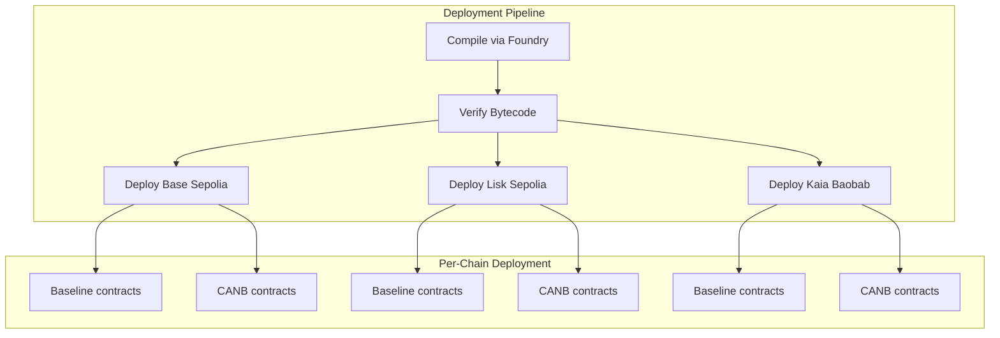
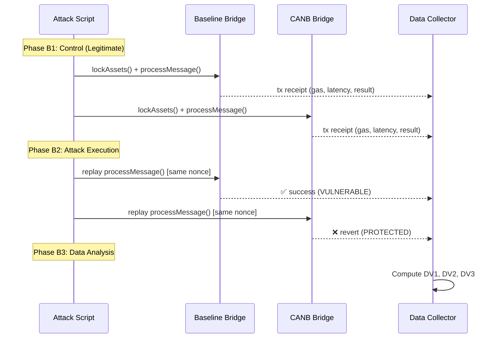

# 📋 Progress Minggu 6 — Desain Schema Deployment dan Planning Attack Method

**Penelitian:** *Mitigation Framework for Double-Spending and Replay Attacks in DeFi Cross-Chain Bridges*
**Periode:** Minggu ke-6 pasca Seminar Proposal
**Status:** ✅ Selesai

---

## 1. Tujuan Minggu Ini

1. Merancang **deployment schema** untuk deploy kontrak ke 3 testnet (Base Sepolia, Lisk Sepolia, Kaia Baobab)
2. Membuat **planning attack method** yang detail — script, tools, dan prosedur eksekusi eksperimen

---

## 2. Deployment Schema

### 2.1 Multi-Chain Deployment Strategy



### 2.2 Deployment Configuration per Testnet

| Parameter | Base Sepolia | Lisk Sepolia | Kaia Baobab |
| :--- | :--- | :--- | :--- |
| **Chain ID** | 84532 | 4202 | 1001 |
| **RPC URL** | `https://sepolia.base.org` | `https://rpc.sepolia-lisk.com` | `https://public-en-baobab.klaytn.net` |
| **Block Time** | ~2s (L2 rollup) | ~3s (DPoS) | ~1s (BFT instant) |
| **Finality Model** | Optimistic (7-day challenge) | DPoS finality | Instant BFT |
| **Gas Token** | ETH (Sepolia) | ETH (Sepolia) | KLAY (Baobab) |
| **Faucet** | Base Sepolia Faucet | Lisk Sepolia Faucet | Klaytn Baobab Faucet |
| **Explorer** | basescan.org (Sepolia) | sepolia-blockscout.lisk.com | baobab.klaytnscope.com |

### 2.3 Contract Deployment Order

Deployment harus sequential karena ada dependency antar contract:

```
Phase 1: Infrastructure
  1. MockERC20 (test token)
  2. DomainSeparator (immutable, chain-specific)

Phase 2: Baseline Bridge
  3. BaselineGateway
  4. BaselineExecutor

Phase 3: CANB Bridge
  5. NonceStore
  6. ContextHasher
  7. ContextValidator
  8. ValidationModule (depends on 5, 6, 7)
  9. BridgeExecutor
  10. CANBGateway (depends on 8, 9)

Phase 4: Configuration
  11. Register relayer addresses
  12. Set cross-chain route mappings
  13. Mint test tokens to test accounts
```

### 2.4 Foundry Deployment Script

```solidity
// script/DeployAll.s.sol
contract DeployAll is Script {
    function run() external {
        uint256 deployerKey = vm.envUint("DEPLOYER_PRIVATE_KEY");
        vm.startBroadcast(deployerKey);
        
        // Phase 1
        MockERC20 token = new MockERC20("TestUSDC", "tUSDC", 6);
        
        // Phase 2: Baseline
        BaselineGateway baseline = new BaselineGateway();
        
        // Phase 3: CANB
        bytes32 bridgeId = keccak256("CANB-BRIDGE-V1");
        DomainSeparator domainSep = new DomainSeparator("CANBBridge", "1", bridgeId);
        NonceStore nonceStore = new NonceStore();
        ContextHasher hasher = new ContextHasher();
        ContextValidator ctxValidator = new ContextValidator();
        ValidationModule valModule = new ValidationModule(
            address(domainSep), address(hasher),
            address(nonceStore), address(ctxValidator)
        );
        BridgeExecutor executor = new BridgeExecutor(address(token));
        CANBGateway canb = new CANBGateway(address(valModule), address(executor));
        
        vm.stopBroadcast();
        
        // Log addresses
        console.log("Token:", address(token));
        console.log("Baseline:", address(baseline));
        console.log("CANB Gateway:", address(canb));
    }
}
```

### 2.5 Environment Configuration

```bash
# .env.base-sepolia
RPC_URL=https://sepolia.base.org
CHAIN_ID=84532
DEPLOYER_PRIVATE_KEY=0x...
ETHERSCAN_API_KEY=...

# .env.lisk-sepolia
RPC_URL=https://rpc.sepolia-lisk.com
CHAIN_ID=4202
DEPLOYER_PRIVATE_KEY=0x...

# .env.kaia-baobab
RPC_URL=https://public-en-baobab.klaytn.net
CHAIN_ID=1001
DEPLOYER_PRIVATE_KEY=0x...
```

```bash
# Deploy ke semua chain
forge script script/DeployAll.s.sol --rpc-url $BASE_SEPOLIA_RPC --broadcast --verify
forge script script/DeployAll.s.sol --rpc-url $LISK_SEPOLIA_RPC --broadcast --verify
forge script script/DeployAll.s.sol --rpc-url $KAIA_BAOBAB_RPC --broadcast --verify
```

---

## 3. Planning Attack Method

### 3.1 Attack Execution Workflow



### 3.2 Attack Script Design (Ethers.js)

```javascript
// scripts/attackRunner.js
class AttackRunner {
    constructor(provider, baselineBridge, canbBridge, attackerWallet) {
        this.provider = provider;
        this.baseline = baselineBridge;
        this.canb = canbBridge;
        this.attacker = attackerWallet;
        this.results = [];
    }
    
    async executeSameContextReplay(originalTx) {
        const result = {
            attackId: `SC-R-${Date.now()}`,
            attackType: 'same_context_replay',
            chain: await this.provider.getNetwork().then(n => n.chainId),
        };
        
        // Replay pada Baseline
        const blTx = await this.baseline.processMessage(
            originalTx.messageHash, originalTx.token,
            originalTx.amount, originalTx.recipient,
            originalTx.sourceChainId, originalTx.nonce,
            originalTx.signature
        );
        const blReceipt = await blTx.wait();
        result.baseline = {
            success: blReceipt.status === 1,
            gasUsed: blReceipt.gasUsed.toString(),
            blockNumber: blReceipt.blockNumber,
        };
        
        // Replay pada CANB
        try {
            const canbTx = await this.canb.submitMessage(/*...same params...*/);
            const canbReceipt = await canbTx.wait();
            result.canb = { success: true, gasUsed: canbReceipt.gasUsed.toString() };
        } catch (e) {
            result.canb = { success: false, revertReason: e.reason };
        }
        
        this.results.push(result);
        return result;
    }
    
    async executeCrossContextReplay(originalTx, targetChainProvider) {
        // Ambil signature dari Chain A, submit ke Chain B
        // ...similar pattern, different provider...
    }
}
```

### 3.3 Data Collection Schema

Setiap test run menghasilkan JSON dataset:

```json
{
  "experimentId": "EXP-2026-W6-001",
  "testnet": "base_sepolia",
  "timestamp": "2026-05-XX",
  "controlPhase": {
    "legitimateTransactions": [
      {
        "txHash": "0x...",
        "gasUsed": 85432,
        "latencyMs": 2100,
        "bridgeType": "baseline",
        "result": "success"
      }
    ]
  },
  "attackPhase": {
    "attacks": [
      {
        "attackId": "SC-R1-BASE-001",
        "attackType": "same_context_replay",
        "baseline": { "success": true, "gasUsed": 85432 },
        "canb": { "success": false, "revertReason": "NONCE_ALREADY_USED", "gasUsed": 23100 }
      }
    ]
  },
  "metrics": {
    "DV1_blockingRate": 100.0,
    "DV2_latencyOverhead_ms": 45,
    "DV3_gasOverhead_pct": 16.8
  }
}
```

### 3.4 Experiment Execution Schedule

| Day | Activity | Target |
| :---: | :--- | :--- |
| 1 | Deploy all contracts ke 3 testnet | 30 contracts total |
| 2 | Control Phase (B1): 50 legitimate tx per chain | 150 tx baseline data |
| 3 | Attack Phase (B2): SC-R attacks (9 variations) | DV1 data collected |
| 4 | Attack Phase (B2): CC-R attacks (9 variations) | DV1 cross-chain data |
| 5 | Attack Phase (B2): Cross-bridge + Type confusion | DV1 complete |
| 6 | Load Phase: 100 concurrent tx per chain | DV2, DV3 under load |
| 7 | Data aggregation dan preliminary analysis | Raw dataset ready |

### 3.5 Statistical Analysis Plan

| Metric | Test | H₀ | H₁ | α |
| :--- | :--- | :--- | :--- | :---: |
| DV1 (Blocking Rate) | Binomial test | rate = 50% | rate ≥ 99.9% | 0.05 |
| DV2 (Latency) | One-sample t-test | overhead ≥ 20% | overhead < 20% | 0.05 |
| DV3 (Gas) | One-sample t-test | overhead ≥ 20% | overhead < 20% | 0.05 |
| Cross-chain comparison | One-way ANOVA | μ_Base = μ_Lisk = μ_Kaia | At least one differs | 0.05 |

---

## 4. Deliverables Minggu 6

- [x] Multi-chain deployment schema (3 testnets)
- [x] Deployment script (Foundry)
- [x] Environment configuration per testnet
- [x] Attack execution workflow & script design (Ethers.js)
- [x] Data collection schema (JSON)
- [x] 7-day experiment execution schedule
- [x] Statistical analysis plan (4 hypothesis tests)

### Transisi ke Minggu 7
Fokus: **Finalisasi smart contract** — code review, unit test coverage, dan memastikan semua contracts ready to deploy.
