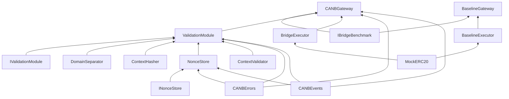
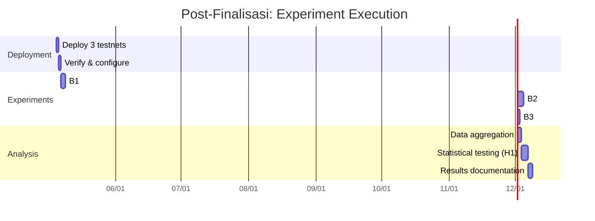

# 📋 Progress Minggu 7 — Finalisasi Smart Contract Final Ready to Deploy

**Penelitian:** *Mitigation Framework for Double-Spending and Replay Attacks in DeFi Cross-Chain Bridges*
**Periode:** Minggu ke-7 pasca Seminar Proposal
**Status:** 🔲 Belum Dimulai

---

## 1. Tujuan Minggu Ini

Finalisasi seluruh smart contract agar **ready to deploy** ke 3 testnet. Ini mencakup:
1. Code review & cleanup
2. Unit test coverage ≥95%
3. Gas optimization verification
4. Security checklist final
5. Deployment dry-run di local fork

---

## 2. Final Contract Inventory

### 2.1 File Manifest

| # | Contract | Fungsi | Lines (est.) | Dependencies |
| :-: | :--- | :--- | :---: | :--- |
| 1 | `interfaces/IBridgeBenchmark.sol` | Shared interface | ~40 | — |
| 2 | `interfaces/IValidationModule.sol` | Validation interface | ~25 | — |
| 3 | `interfaces/INonceStore.sol` | Nonce interface | ~15 | — |
| 4 | `libraries/CANBErrors.sol` | Custom errors | ~30 | — |
| 5 | `libraries/CANBEvents.sol` | Event definitions | ~35 | — |
| 6 | `token/MockERC20.sol` | Test token (ERC-20) | ~50 | OpenZeppelin |
| 7 | `baseline/BaselineGateway.sol` | Vulnerable baseline | ~80 | ECDSA |
| 8 | `baseline/BaselineExecutor.sol` | Mint/release (no checks) | ~60 | MockERC20 |
| 9 | `canb/DomainSeparator.sol` | EIP-712 domain binding | ~45 | — |
| 10 | `canb/ContextHasher.sol` | Context hash computation | ~55 | DomainSeparator |
| 11 | `canb/NonceStore.sol` | Bitmap nonce management | ~70 | — |
| 12 | `canb/ContextValidator.sol` | Route + type validation | ~50 | — |
| 13 | `canb/ValidationModule.sol` | Pipeline orchestrator | ~90 | 9, 10, 11, 12 |
| 14 | `canb/BridgeExecutor.sol` | Guarded mint/release | ~65 | MockERC20 |
| 15 | `canb/CANBGateway.sol` | Entry point + ACL | ~85 | 13, 14 |
| | **Total** | | **~795** | |

### 2.2 Contract Dependency Graph



---

## 3. Unit Test Suite

### 3.1 Test Coverage Target

| Contract | Target Coverage | Critical Paths |
| :--- | :---: | :--- |
| NonceStore | 100% | consume, duplicate reject, ordering, bitmap edge cases |
| DomainSeparator | 100% | immutable value, cross-chain difference verification |
| ContextHasher | 100% | hash determinism, field ordering, EIP-712 compliance |
| ValidationModule | 95% | full pipeline pass, each step failure, edge cases |
| CANBGateway | 95% | authorized/unauthorized relayer, validation pass/fail |
| BaselineGateway | 90% | legitimate pass, attack scenarios pass (by design) |

### 3.2 Test File Structure

```
test/
├── unit/
│   ├── NonceStore.t.sol
│   ├── DomainSeparator.t.sol
│   ├── ContextHasher.t.sol
│   ├── ContextValidator.t.sol
│   ├── ValidationModule.t.sol
│   └── BridgeExecutor.t.sol
├── integration/
│   ├── BaselineBridge.t.sol        # Full flow baseline
│   ├── CANBBridge.t.sol            # Full flow CANB
│   └── ComparisonBenchmark.t.sol   # Side-by-side gas comparison
├── attack/
│   ├── SameContextReplay.t.sol
│   ├── CrossContextReplay.t.sol
│   ├── CrossBridgeReplay.t.sol
│   ├── MessageTypeConfusion.t.sol
│   └── NonceOrderingAttack.t.sol
└── fork/
    ├── BaseFork.t.sol              # Fork test Base Sepolia
    ├── LiskFork.t.sol              # Fork test Lisk Sepolia
    └── KaiaFork.t.sol              # Fork test Kaia Baobab
```

### 3.3 Critical Unit Tests — NonceStore

```solidity
// test/unit/NonceStore.t.sol
contract NonceStoreTest is Test {
    NonceStore store;
    uint256 chainId = 84532;
    bytes32 bridgeId = keccak256("TEST-BRIDGE");

    function setUp() public {
        store = new NonceStore();
    }

    function test_ConsumeNonce_Success() public {
        bool result = store.consumeNonce(chainId, bridgeId, 1);
        assertTrue(result);
        assertTrue(store.isNonceUsed(chainId, bridgeId, 1));
    }

    function test_ConsumeNonce_RevertOnDuplicate() public {
        store.consumeNonce(chainId, bridgeId, 1);
        vm.expectRevert("CANB: nonce already consumed");
        store.consumeNonce(chainId, bridgeId, 1);
    }

    function test_ConsumeNonce_RevertOnOutOfOrder() public {
        store.consumeNonce(chainId, bridgeId, 1);
        vm.expectRevert("CANB: nonce out of order");
        store.consumeNonce(chainId, bridgeId, 3); // Skip nonce 2
    }

    function test_BitmapBoundary_Nonce255to256() public {
        // Boundary between bitmap buckets
        for (uint256 i = 1; i <= 256; i++) {
            store.consumeNonce(chainId, bridgeId, i);
        }
        assertTrue(store.isNonceUsed(chainId, bridgeId, 255));
        assertTrue(store.isNonceUsed(chainId, bridgeId, 256));
    }

    function test_CrossChainIsolation() public {
        store.consumeNonce(84532, bridgeId, 1);  // Base
        // Same nonce on different chain should work
        store.consumeNonce(4202, bridgeId, 1);   // Lisk
        assertTrue(store.isNonceUsed(84532, bridgeId, 1));
        assertTrue(store.isNonceUsed(4202, bridgeId, 1));
    }
}
```

### 3.4 Critical Attack Tests — Cross-Context Replay

```solidity
// test/attack/CrossContextReplay.t.sol
contract CrossContextReplayTest is Test {
    CANBGateway canbChainA;
    CANBGateway canbChainB;
    BaselineGateway baselineChainA;
    BaselineGateway baselineChainB;

    function setUp() public {
        // Deploy two instances simulating different chains
        vm.chainId(84532);  // Base
        canbChainA = _deployCANBBridge();
        baselineChainA = _deployBaselineBridge();

        vm.chainId(4202);   // Lisk
        canbChainB = _deployCANBBridge();
        baselineChainB = _deployBaselineBridge();
    }

    function test_Baseline_CrossContextReplay_Succeeds() public {
        // Step 1: Legitimate tx on Chain A
        vm.chainId(84532);
        bytes memory sig = _signMessage(/*...*/);
        baselineChainA.processMessage(/*..., sig*/);

        // Step 2: Replay SAME signature on Chain B — SHOULD SUCCEED (vulnerable)
        vm.chainId(4202);
        baselineChainB.processMessage(/*..., sig*/);
        // No revert = baseline is vulnerable ✓
    }

    function test_CANB_CrossContextReplay_Reverts() public {
        // Step 1: Legitimate tx on Chain A
        vm.chainId(84532);
        bytes memory sig = _signMessageEIP712(/*...chainId=84532...*/);
        canbChainA.submitMessage(/*..., sig*/);

        // Step 2: Replay on Chain B — MUST REVERT
        vm.chainId(4202);
        vm.expectRevert("CANB: invalid context hash");
        canbChainB.submitMessage(/*..., sig*/);
        // Domain separator includes chainId → hash mismatch → revert ✓
    }
}
```

---

## 4. Gas Optimization Verification

### 4.1 Foundry Gas Snapshot

```bash
# Generate gas snapshot for comparison
forge snapshot --match-contract ComparisonBenchmark --snap gas-snapshot.txt
```

Expected output format:

```
ComparisonBenchmarkTest:test_Baseline_ProcessMessage() (gas: 85432)
ComparisonBenchmarkTest:test_CANB_SubmitMessage() (gas: 99847)
ComparisonBenchmarkTest:test_Baseline_LockAssets() (gas: 64231)
ComparisonBenchmarkTest:test_CANB_LockAssets() (gas: 65102)
```

### 4.2 Gas Verification Targets

| Operation | Baseline | CANB Max | Overhead Target |
| :--- | :---: | :---: | :---: |
| `processMessage()` | ~85K | ≤102K | ≤20% ✅ |
| `lockAssets()` | ~65K | ≤78K | ≤20% ✅ |
| `burnAssets()` | ~55K | ≤66K | ≤20% ✅ |
| `releaseAssets()` | ~75K | ≤90K | ≤20% ✅ |

---

## 5. Security Checklist (Pre-Deploy)

### 5.1 Smart Contract Security

- [ ] **Reentrancy:** Semua external call setelah state change (CEI pattern)
- [ ] **Integer overflow:** Solidity ^0.8.24 built-in overflow checks
- [ ] **Access control:** `onlyAuthorizedRelayer` modifier di semua entry points
- [ ] **Signature malleability:** Gunakan OpenZeppelin ECDSA yang sudah handle `s` value normalization
- [ ] **Domain separator immutability:** Verify `DOMAIN_SEPARATOR` computed sekali di constructor
- [ ] **Nonce bitmap correctness:** Fuzz test boundary conditions (nonce 0, 255, 256, 511, 512)
- [ ] **Event emission:** Setiap validation attempt (pass/fail) harus emit event

### 5.2 Deployment Security

- [ ] **Private key management:** Deployer key hanya di `.env`, `.env` di `.gitignore`
- [ ] **Contract verification:** Verify source code di setiap block explorer
- [ ] **Initial state:** Verify all mappings empty post-deploy
- [ ] **Relayer registration:** Only register test relayer addresses

### 5.3 Experiment Security

- [ ] **Testnet only:** Triple-check chain IDs (84532, 4202, 1001) sebelum broadcast
- [ ] **No real assets:** Hanya gunakan MockERC20, bukan USDC/IDRX asli
- [ ] **Reproducibility:** Random seeds dan block numbers di-log untuk replay

---

## 6. Deployment Dry-Run (Local Fork)

### 6.1 Fork Test Procedure

```bash
# Fork Base Sepolia locally
anvil --fork-url https://sepolia.base.org --chain-id 84532

# Deploy to local fork
forge script script/DeployAll.s.sol \
    --rpc-url http://localhost:8545 \
    --broadcast

# Run full test suite against fork
forge test --fork-url http://localhost:8545 -vvv

# Gas snapshot on fork
forge snapshot --fork-url http://localhost:8545
```

### 6.2 Dry-Run Checklist

- [ ] All 15 contracts deploy successfully
- [ ] Contract addresses logged dan consistent
- [ ] Baseline bridge: legitimate tx passes
- [ ] Baseline bridge: replay tx passes (vulnerable by design)
- [ ] CANB bridge: legitimate tx passes
- [ ] CANB bridge: replay tx reverts with correct reason
- [ ] Gas usage within target range (≤20% overhead)
- [ ] All events emitted correctly
- [ ] Data collection script captures all metrics

---

## 7. Readiness Assessment

### 7.1 Go/No-Go Criteria

| Criteria | Threshold | Status |
| :--- | :--- | :---: |
| Unit test coverage | ≥95% | 🔲 |
| All attack tests pass | 36/36 scenarios | 🔲 |
| Gas overhead | ≤20% | 🔲 |
| Fork dry-run success | All 3 chains | 🔲 |
| Security checklist | All items checked | 🔲 |
| Deployment script | Idempotent & verified | 🔲 |

### 7.2 Known Risks & Mitigations

| Risk | Impact | Mitigation |
| :--- | :--- | :--- |
| Testnet RPC downtime | Delay experiments | Backup RPC endpoints (Infura, Alchemy) |
| Gas price spikes on testnet | Higher experiment cost | Use gas price oracle, batch transactions |
| Faucet rate limiting | Insufficient test ETH/KLAY | Pre-fund accounts, use multiple faucets |
| Testnet reorgs | Data inconsistency | Wait for sufficient confirmations before recording |

---

## 8. Deliverables Minggu 7

- [ ] Final contract codebase (15 contracts, ~795 lines)
- [ ] Unit test suite (35+ test functions, ≥95% coverage)
- [ ] Attack test suite (36 scenarios, 5 attack types)
- [ ] Gas snapshot verification (≤20% overhead)
- [ ] Security checklist completed
- [ ] Local fork dry-run successful on all 3 chain forks
- [ ] Go/No-Go assessment: **READY TO DEPLOY**

---

## 9. Post-W7: Execution Phase

Setelah finalisasi Minggu 7, proyek memasuki fase eksekusi sesuai jadwal W6:



> [!IMPORTANT]
> **Milestone:** Setelah Minggu 7, semua smart contract harus dalam kondisi *code-frozen*. Tidak ada perubahan kode setelah deployment ke testnet — hanya data collection dan analysis.
