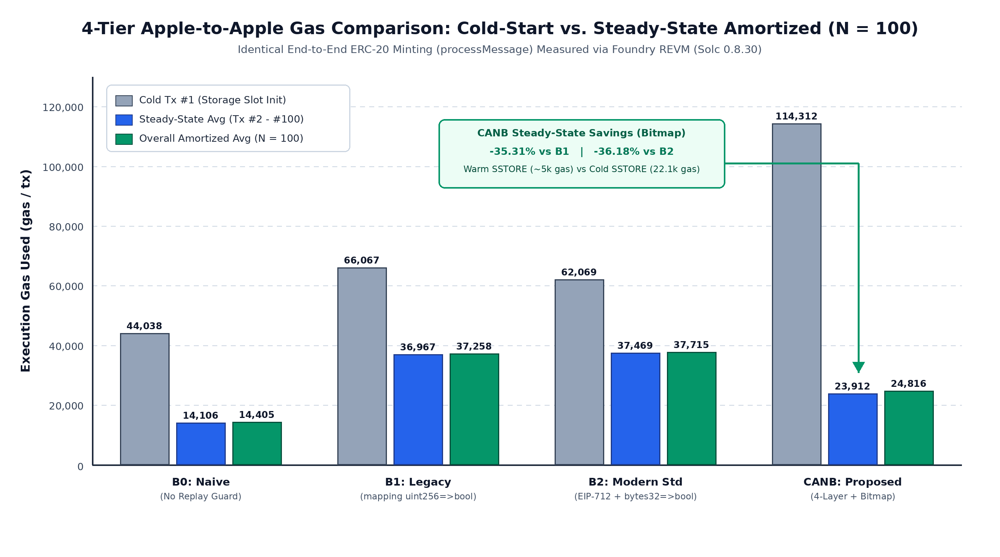

# Progres Semester 3 (Implementasi Proyek 2): Validasi Empiris 4-Tier (70% Selesai)

**Tanggal:** 25 November 2026  
**Milestone:** Semester 3 — *Implementasi Proyek 2* (**70% Overall Completion**)  
**Status Verifikasi:** **114/114 Passing Tests** (`Solc 0.8.30`, Foundry `forge 1.7.1`)

---

## 1. Ringkasan Capaian Utama

Pada fase pemantauan Semester 3 (*Implementasi Proyek 2*), penelitian menyelesaikan audit internal *ceteris paribus* dan meningkatkan arsitektur komparasi menjadi **4-Tier (`B0/B1/B2/CANB`)** untuk menyelaraskan evaluasi terhadap standar industri cross-chain modern (LayerZero V2, Wormhole, Hyperlane, Chainlink CCIP, ERC-7683/Permit2):

1. **Implementasi Baseline 4-Tier (*Ceteris Paribus*):**
   - `B0`: `BaselineGateway.sol` (Naive, tanpa replay guard, terhubung penuh ke `BaselineExecutor`).
   - `B1`: `ConventionalGateway.sol` (Legacy `mapping(uint256 => bool)` + raw ECDSA tanpa EIP-712).
   - `B2`: `ModernStandardGateway.sol` (Modern EIP-712 `DomainSeparator` + `mapping(bytes32 => bool)` + CEI ala Wormhole/Hyperlane).
   - `CANB`: `CANBGateway.sol` (Full 4-Layer + Time-Bounded Bitmap `NonceStore`).
2. **Ekspansi Attack Suite (47/47 Passing):**
   - Penambahan `SleepingReplay.t.sol` (**AV-1-1**, 5 skenario termasuk exact boundary $T = 3600\text{s}$ vs $T+1\text{s}$).
   - Penambahan `FourTierSecurityMatrix.t.sol` (6 skenario komparasi `B0/B1/B2/CANB` + pembuktian invarian $\Delta\text{Assets} = 0$).
3. **Stage E3 Amortized Gas Benchmark (`N = 50` & `N = 100`):**
   - CANB mencatat **23,912 gas/tx** pada *steady-state* (**-35.31% lebih hemat dari B1** dan **-36.18% lebih hemat dari B2**), serta **24,816 gas/tx** *overall amortized* pada $N = 100$ (**-33.39% vs B1**, **-34.20% vs B2**).
   - Visualisasi grafik 300 DPI dihasilkan pada `assets/gas_comparison_4tier.png`.

## 2. Justifikasi Metodologis
- **Eliminasi *Strawman Bias* (Penambahan B2):** Membuktikan nilai tambah CANB bahkan melawan pola standar industri modern (`mapping(bytes32 => bool)` + EIP-712).
- **Local-First Verification vs. Multi-Testnet:** Memastikan validitas internal (DV1, DV2, DV3) secara deterministik di REVM terlebih dahulu sebelum mengumpulkan variabel eksternal (DV4 *latency*, L1 DA fee, *timestamp drift*, ANOVA) pada 3 testnet publik (Base Sepolia, Lisk Sepolia, Kaia Kairos) sebagai 30% sisa menuju sidang.

