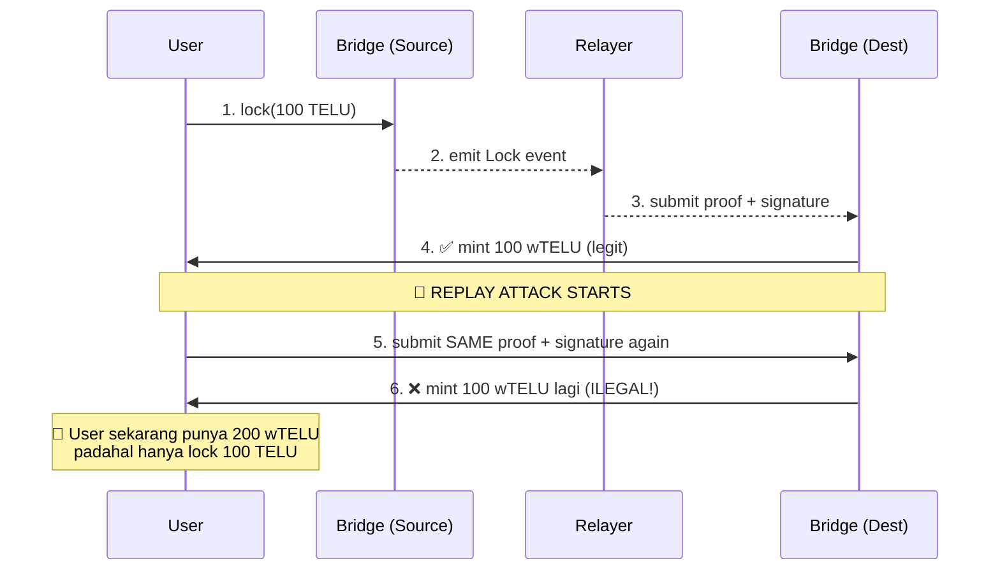
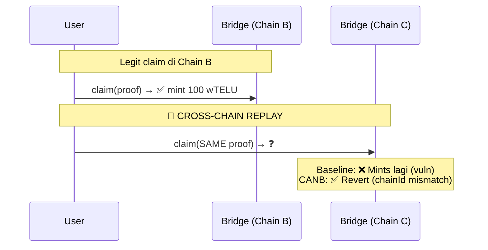
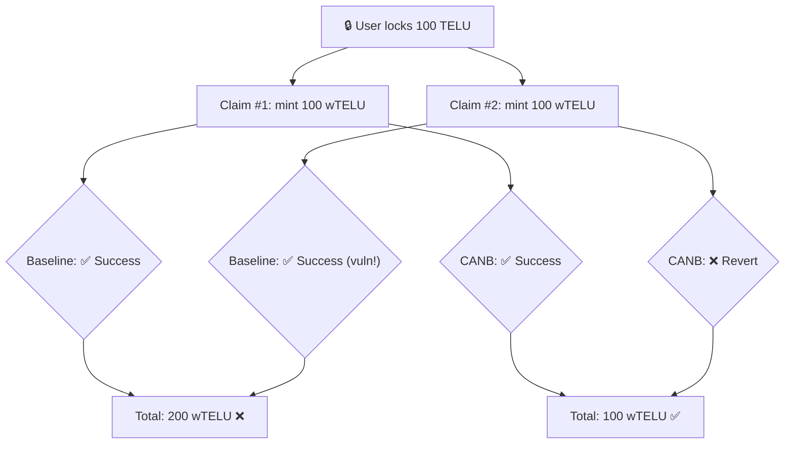

# ⚔️ Attack Simulation Scenarios
## Cara Kerja Serangan di Cross-Chain Bridge

---

## 🔁 Replay Attack — Penjelasan

### Apa itu Replay Attack?
User melakukan **1 kali lock** di source chain, tapi **claim berkali-kali** di destination chain menggunakan proof/signature yang sama.



### Di Foundry Test — Cara Simulasi:

```solidity
// ============================================================
//  REPLAY ATTACK TEST — BASELINE BRIDGE (VULNERABLE)
// ============================================================

function test_Baseline_ReplayAttack_SameChain() public {
    // ── Setup: User lock 100 token di source chain ──
    uint256 amount = 100 ether;
    vm.prank(user);
    token.approve(address(baselineBridge), amount);
    
    vm.prank(user);
    baselineBridge.lockTokens(amount, destChainId, recipient);
    
    // ── Relayer membuat signature untuk claim ──
    bytes32 messageHash = keccak256(abi.encodePacked(
        user, recipient, amount, nonce
    ));
    (uint8 v, bytes32 r, bytes32 s) = vm.sign(relayerPrivateKey, messageHash);
    bytes memory signature = abi.encodePacked(r, s, v);
    
    // ── Claim pertama (legit) ──
    vm.prank(recipient);
    baselineBridge.claimTokens(user, recipient, amount, nonce, signature);
    
    assertEq(wrappedToken.balanceOf(recipient), 100 ether); // ✅ 100 token
    
    // ══════════════════════════════════════════════════
    //  🔴 REPLAY: Gunakan signature yang SAMA untuk claim lagi
    // ══════════════════════════════════════════════════
    vm.prank(recipient);
    baselineBridge.claimTokens(user, recipient, amount, nonce, signature);
    
    // ❌ VULNERABILITY: Recipient sekarang punya 200 token!
    assertEq(wrappedToken.balanceOf(recipient), 200 ether);
    // Padahal hanya lock 100 → ini DOUBLE MINTING / REPLAY
}
```

```solidity
// ============================================================
//  REPLAY ATTACK TEST — CANB BRIDGE (PROTECTED) ✅
// ============================================================

function test_CANB_ReplayAttack_SameChain_Reverts() public {
    // ── Setup: User lock 100 token ──
    uint256 amount = 100 ether;
    vm.prank(user);
    token.approve(address(canbBridge), amount);
    
    vm.prank(user);
    bytes32 contextNonce = canbBridge.lockTokens(amount, destChainId, recipient);
    
    // ── Relayer membuat signature (sekarang termasuk contextNonce) ──
    bytes32 messageHash = keccak256(abi.encodePacked(
        sourceChainId, destChainId,
        address(canbBridge),
        user, recipient, amount,
        contextNonce  // ← CANB nonce ikut di-sign
    ));
    (uint8 v, bytes32 r, bytes32 s) = vm.sign(relayerPrivateKey, messageHash);
    bytes memory signature = abi.encodePacked(r, s, v);
    
    // ── Claim pertama (legit) ──
    vm.prank(recipient);
    canbBridge.claimTokens(user, recipient, amount, contextNonce, signature);
    
    assertEq(wrappedToken.balanceOf(recipient), 100 ether); // ✅ 100 token
    
    // ══════════════════════════════════════════════════
    //  🔴 REPLAY: Coba gunakan signature yang SAMA
    // ══════════════════════════════════════════════════
    vm.prank(recipient);
    vm.expectRevert("Nonce already used");  // ✅ CANB menolak!
    canbBridge.claimTokens(user, recipient, amount, contextNonce, signature);
    
    // ✅ Balance tetap 100, serangan GAGAL
    assertEq(wrappedToken.balanceOf(recipient), 100 ether);
}
```

---

## 🔀 Cross-Chain Replay Attack

### Apa itu Cross-Chain Replay?
Proof yang valid di **Chain B** dicoba digunakan di **Chain C** (chain lain yang juga punya bridge).



### Di Foundry Test:

```solidity
// ============================================================
//  CROSS-CHAIN REPLAY — BASELINE (VULNERABLE)
// ============================================================

function test_Baseline_CrossChainReplay() public {
    // Signature dibuat TANPA chain ID binding
    bytes32 messageHash = keccak256(abi.encodePacked(
        user, recipient, amount, nonce
        // ❌ Tidak ada chainId atau bridge address!
    ));
    bytes memory signature = _sign(messageHash);
    
    // Claim di Bridge Chain B → berhasil
    vm.prank(recipient);
    bridgeChainB.claimTokens(user, recipient, amount, nonce, signature);
    
    // 🔴 REPLAY di Bridge Chain C → JUGA berhasil (VULNERABILITY!)
    vm.prank(recipient);
    bridgeChainC.claimTokens(user, recipient, amount, nonce, signature);
    
    // ❌ User dapat token di DUA chain dari 1 lock event
}

// ============================================================
//  CROSS-CHAIN REPLAY — CANB (PROTECTED) ✅
// ============================================================

function test_CANB_CrossChainReplay_Reverts() public {
    // CANB signature termasuk chainId + bridge address
    bytes32 contextNonce = keccak256(abi.encodePacked(
        uint256(1),          // source chain ID
        uint256(137),        // dest chain ID = Polygon
        address(bridgeB),    // bridge address Chain B
        user, recipient, amount, block.timestamp, seqNonce
    ));
    bytes memory signature = _signWithContext(contextNonce);
    
    // Claim di Bridge Chain B (chainId=137) → berhasil
    vm.chainId(137);
    vm.prank(recipient);
    bridgeChainB.claimTokens(user, recipient, amount, contextNonce, signature);
    
    // 🔴 Replay di Bridge Chain C (chainId=42161 / Arbitrum)
    vm.chainId(42161);
    vm.prank(recipient);
    vm.expectRevert("Invalid context nonce");  // ✅ CANB menolak!
    bridgeChainC.claimTokens(user, recipient, amount, contextNonce, signature);
}
```

> [!NOTE]
> Foundry menyediakan cheatcode `vm.chainId(uint256)` yang memungkinkan kita **mengubah chain ID** dalam test. Ini yang membuat simulasi cross-chain replay bisa dilakukan dalam satu test file.

---

## 💸 Double Spending Attack

### Apa itu Double Spending?
User lock 100 token **sekali**, tapi mencoba **claim 2x** (baik secara bersamaan atau berurutan) sehingga mendapat 200 wrapped token.



### Di Foundry Test:

```solidity
// ============================================================
//  DOUBLE SPENDING — BASELINE (VULNERABLE)
// ============================================================

function test_Baseline_DoubleSpend() public {
    uint256 amount = 100 ether;

    // User lock sekali
    vm.prank(user);
    baselineBridge.lockTokens(amount, destChainId, recipient);
    
    bytes memory signature = _createSignature(user, recipient, amount, nonce);
    
    // ── Claim #1 ──
    vm.prank(recipient);
    baselineBridge.claimTokens(user, recipient, amount, nonce, signature);
    
    // ── Claim #2 (double spend!) ──
    vm.prank(recipient);
    baselineBridge.claimTokens(user, recipient, amount, nonce, signature);
    
    // ❌ Recipient punya 200 tapi hanya lock 100
    assertEq(wrappedToken.balanceOf(recipient), 200 ether);
}

// ============================================================
//  DOUBLE SPENDING — CANB (PROTECTED) ✅ 
// ============================================================

function test_CANB_DoubleSpend_Reverts() public {
    uint256 amount = 100 ether;
    
    vm.prank(user);
    bytes32 ctxNonce = canbBridge.lockTokens(amount, destChainId, recipient);
    
    bytes memory signature = _createCANBSignature(
        user, recipient, amount, ctxNonce
    );
    
    // ── Claim #1 (legit) ──
    vm.prank(recipient);
    canbBridge.claimTokens(user, recipient, amount, ctxNonce, signature);
    
    // ── Claim #2 (double spend attempt!) ──
    vm.prank(recipient);
    vm.expectRevert("Nonce already used");  // ✅ Ditolak!
    canbBridge.claimTokens(user, recipient, amount, ctxNonce, signature);
    
    // ✅ Balance tetap 100
    assertEq(wrappedToken.balanceOf(recipient), 100 ether);
}
```

---

## 🎭 Manipulated Amount Attack

### Skenario: Attacker mengubah amount di proof

```solidity
// ============================================================
//  AMOUNT MANIPULATION — CANB (PROTECTED) ✅
// ============================================================

function test_CANB_ManipulatedAmount_Reverts() public {
    uint256 lockAmount = 100 ether;
    uint256 fakeAmount = 1_000_000 ether;  // 🔴 Attacker inflates amount
    
    vm.prank(user);
    bytes32 ctxNonce = canbBridge.lockTokens(lockAmount, destChainId, recipient);
    // ctxNonce = hash(..., lockAmount=100, ...)
    
    // Attacker tries to claim with inflated amount
    // but the contextNonce was generated with the REAL amount
    bytes32 fakeCtxNonce = keccak256(abi.encodePacked(
        sourceChainId, destChainId,
        address(canbBridge),
        user, recipient,
        fakeAmount,  // 🔴 1,000,000 instead of 100
        block.timestamp, seqNonce
    ));
    
    bytes memory fakeSignature = _sign(fakeCtxNonce);
    
    vm.prank(recipient);
    vm.expectRevert("Invalid context nonce");  // ✅ Hash mismatch!
    canbBridge.claimTokens(user, recipient, fakeAmount, fakeCtxNonce, fakeSignature);
}
```

---

## 📊 Ringkasan Attack Vectors

| Attack Vector | Cara Simulasi di Foundry | Baseline Result | CANB Result |
|---|---|---|---|
| **Same-chain replay** | Call `claimTokens()` 2x dengan params sama | ❌ Mint 2x (vuln) | ✅ Revert |
| **Cross-chain replay** | `vm.chainId()` lalu claim di bridge lain | ❌ Mint di chain lain (vuln) | ✅ Revert (chainId binding) |
| **Double spending** | 1 lock, 2 claim | ❌ Mint 2x (vuln) | ✅ Revert (nonce used) |
| **Amount manipulation** | Ubah amount di claim params | ❌ Bisa jika signature valid | ✅ Revert (amount in hash) |
| **Different bridge replay** | Deploy 2 bridge, replay proof | ❌ Bisa jika tanpa address binding | ✅ Revert (bridge addr in hash) |
| **Stale proof replay** | Gunakan proof lama setelah lama waktu | ❌ Bisa | ✅ Revert (timestamp + nonce) |

---

## 🔧 Foundry Cheatcodes yang Akan Digunakan

| Cheatcode | Kegunaan |
|---|---|
| `vm.prank(address)` | Pura-pura jadi address tertentu (user/attacker) |
| `vm.sign(privateKey, hash)` | Generate ECDSA signature (untuk relayer) |
| `vm.expectRevert("message")` | Verify bahwa transaksi akan revert |
| `vm.chainId(uint256)` | Ubah chain ID (untuk cross-chain test) |
| `vm.warp(timestamp)` | Ubah block timestamp |
| `vm.deal(address, amount)` | Beri ETH ke address |
| `vm.record()` / `vm.accesses()` | Track storage access untuk gas analysis |

---

> [!IMPORTANT]
> **Kunci output thesis:** Setiap test yang `PASS` di baseline (artinya serangan **berhasil** = sistem **vulnerable**) harus `REVERT` di CANB (artinya serangan **gagal** = sistem **secure**). Kontras ini yang menjadi bukti efektivitas CANB.

> [!TIP]
> Gunakan naming convention yang konsisten: `test_Baseline_*` dan `test_CANB_*` agar mudah di-filter dengan `forge test --match-contract` atau `--match-test`.
