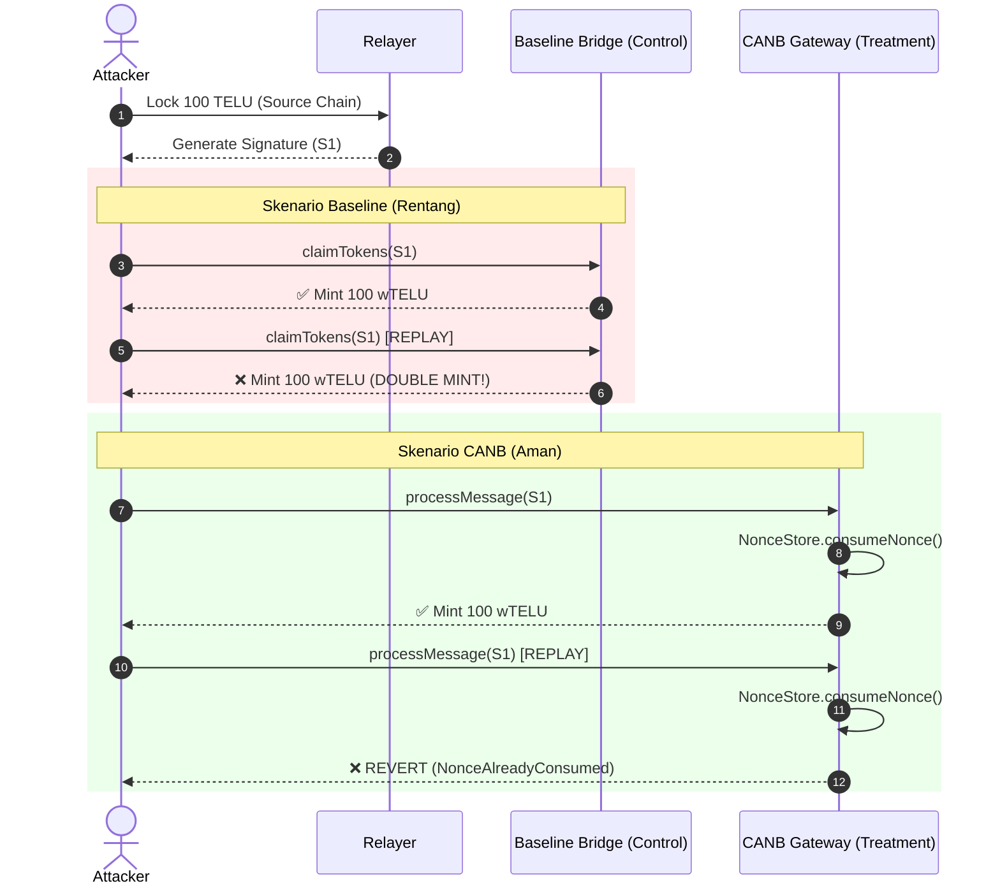

# AV-1: Same-Chain Replay Attack

## Deskripsi Vektor Serangan
Dalam skenario serangan ini, seorang pengguna (atau *attacker*) yang sah melakukan penguncian aset (lock) **satu kali** di *source chain*. Ketika *relayer* men-generate bukti kriptografis (*proof/signature*) untuk mencairkan token di *destination chain*, penyerang menangkap *signature* tersebut.

Setelah penyerang mengklaim aset secara sah, ia kembali **mengirimkan ulang (replay)** *signature* yang persis sama ke *smart contract* tujuan untuk mencetak (*mint*) token lagi secara ilegal.

## Diagram Simulasi Serangan (Baseline vs CANB)

## Analisis Mitigasi CANB
CANB memitigasi serangan ini menggunakan modul `NonceStore`. Setiap *nonce* direpresentasikan dalam struktur *bitmap* biner (`uint256`). Ketika *signature* `S1` dieksekusi pertama kali, bit *nonce* akan diubah dari `0` menjadi `1`. Pada saat penyerang mencoba me-replay `S1`, `NonceStore` mengecek bit tersebut dan langsung menggagalkan transaksi (REVERT) karena mendeteksi *nonce* yang sama.
