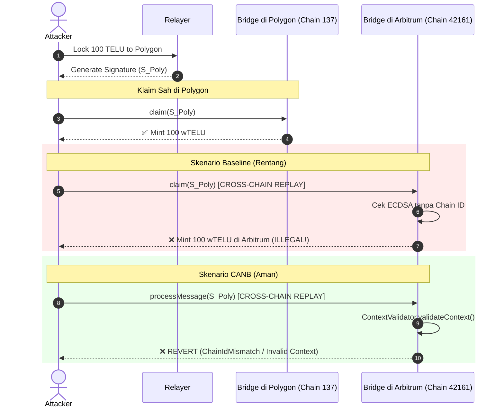

# AV-2: Cross-Chain Replay Attack

## Deskripsi Vektor Serangan
Berbeda dengan AV-1, pada serangan *Cross-Chain Replay*, penyerang menggunakan *signature* sah yang ditujukan untuk **Chain A**, namun ia mengirimkannya (*submit*) ke instansiasi *bridge* yang berada di **Chain B** atau **Chain C**. 

Jika *smart contract* tidak mengikat pesan dengan identitas jaringan (*Chain ID*), *bridge* di rantai lain akan menganggap *signature* tersebut valid dan mencairkan aset yang seharusnya tidak ada.

## Diagram Simulasi Serangan (Baseline vs CANB)

## Analisis Mitigasi CANB
Serangan AV-2 dimitigasi secara penuh menggunakan dua lapisan pertahanan ganda:
1.  **ContextHasher & DomainSeparator (EIP-712):** Mengikat tanda tangan kriptografis dengan `block.chainid` tempat kontrak di-*deploy*.
2.  **ContextValidator:** Secara eksplisit menolak (REVERT) pesan masuk yang mana `destinationChainId` tidak sesuai dengan parameter lokal rantai yang sedang berjalan.
