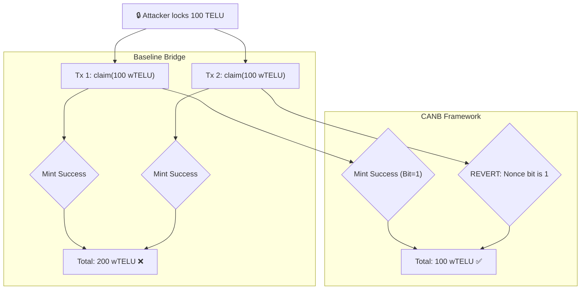

# AV-3: Double Spending Attack

## Deskripsi Vektor Serangan
*Double Spending* (Pembelanjaan Ganda) adalah varian dari *replay attack* yang berfokus pada sisi temporal. Pada skenario ini, pengguna memiliki *signature* yang valid untuk pencairan aset. Penyerang menembakkan **dua transaksi secara paralel (atau berurutan dengan sangat cepat)** ke jaringan dengan *signature* yang sama. 

Tujuannya adalah untuk mengeksploitasi keterlambatan pembaruan *state* (*state update delay*) dari *smart contract*. Jika kontrak memperbarui nilai *balance* atau *nonce* SETELAH pencetakan token, ada risiko eksekusi paralel menyebabkan token dicetak ganda.

## Diagram Simulasi Serangan (Baseline vs CANB)

## Analisis Mitigasi CANB
CANB menangani AV-3 melalui implementasi ketat dari modul `BridgeExecutor` yang mengadopsi pola **Checks-Effects-Interactions (CEI)** dan modul `NonceStore`.
1.  `NonceStore` mengkonsumsi *nonce* (Checks & Effects) pada saat validasi SEBELUM eksekutor token dipanggil. 
2.  Karena penulisan memori EVM untuk struktur *bitmap* terjadi di level transaksional yang atomik, transaksi kedua yang dieksekusi pada *block* yang sama atau setelahnya akan secara matematis membaca bit *nonce* bernilai `1` dan langsung di-*revert*.
