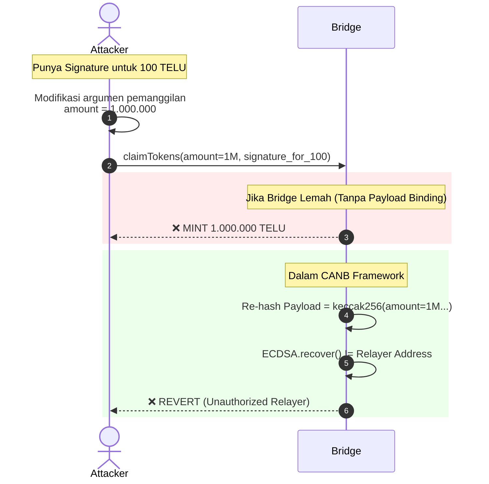

# AV-4: Amount Manipulation Attack

## Deskripsi Vektor Serangan
Dalam serangan *Amount Manipulation*, penyerang menerima *signature* yang sah untuk mengklaim jumlah token tertentu (misalnya, 100 TELU). Penyerang tidak me-replay transaksi tersebut, melainkan ia mengubah argumen panggilan fungsi (misalnya `amount` menjadi `1,000,000 TELU`) ketika menyerahkannya ke *smart contract*.

Jika *smart contract* hanya memverifikasi *signature* tanpa mencocokkan hash data (payload) di dalamnya, *smart contract* akan mentransfer jumlah yang dimanipulasi oleh penyerang.

## Diagram Simulasi Serangan (Baseline vs CANB)

## Analisis Mitigasi CANB
Serangan ini mustahil dilakukan di CANB karena struktur `ContextHasher`. CANB tidak pernah mempercayai input pengguna secara langsung. Fungsi validasi menerima data (seperti `amount`, `recipient`) dari pengguna, melakukan komputasi *hash* EIP-712 ulang di dalam *smart contract*, dan mencocokkannya dengan *signature*. 

Setiap perubahan sekecil apa pun pada data (meski hanya 1 *wei* pada `amount`) akan merusak hasil *hash*, sehingga alamat penandatangan (`recover`) akan berubah menjadi alamat acak, yang kemudian akan diblokir oleh daftar relayer terotorisasi di `ValidationModule`.
