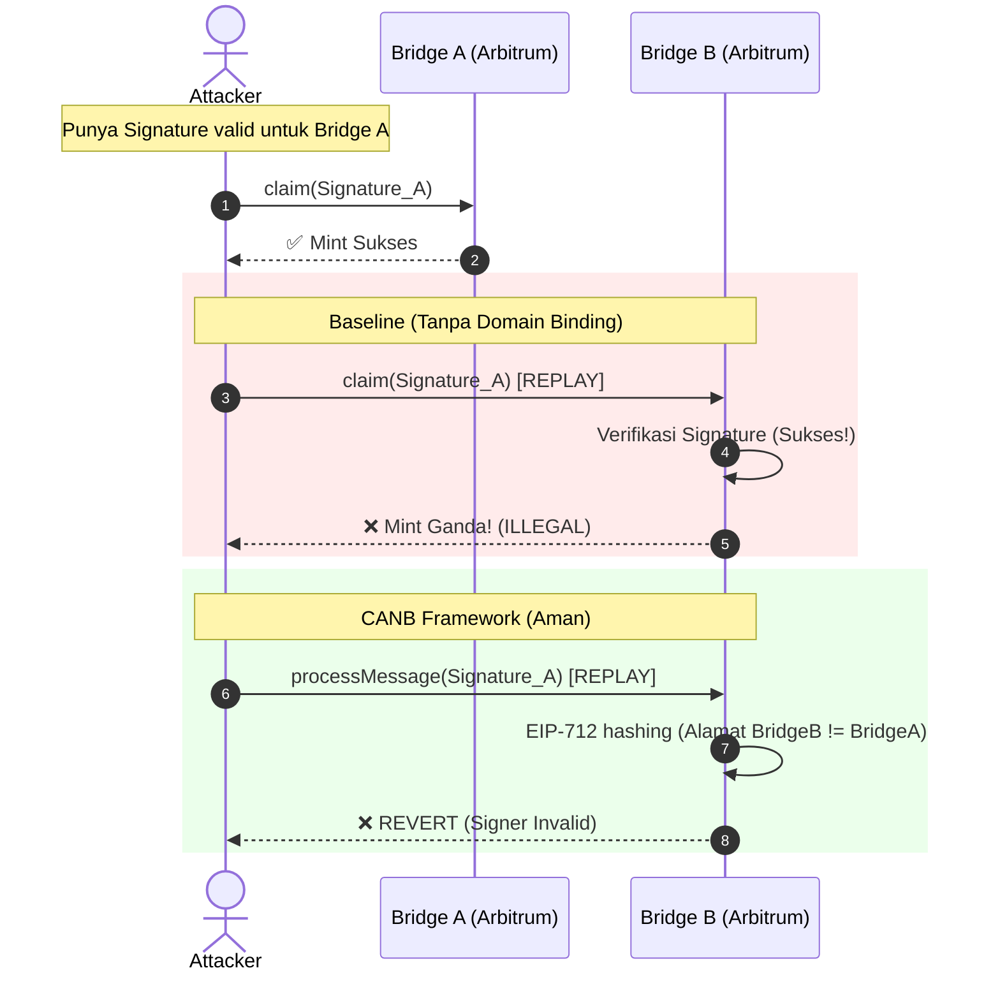

# AV-5: Different Bridge Replay Attack

## Deskripsi Vektor Serangan
Serangan ini (*Different Bridge Replay*) adalah sub-varian serangan lintas-rantai, namun terjadi di jaringan yang **sama**. 

Skenarionya: ada dua jembatan (atau lebih) beroperasi di rantai yang sama. Misalnya, `Bridge A` dan `Bridge B` berjalan di jaringan Arbitrum. Penyerang mendapatkan *signature* pencairan untuk `Bridge A` dan berusaha mengklaimnya di `Bridge B`. Jika protokol *bridge* gagal mengikat identitas (alamat kontrak) secara eksplisit ke dalam tanda tangan, `Bridge B` akan membaca *signature* tersebut, memverifikasinya (karena *relayer* yang bertugas sama), dan mencairkan token secara keliru.

## Diagram Simulasi Serangan (Baseline vs CANB)

## Analisis Mitigasi CANB
Serangan semacam ini sepenuhnya digagalkan oleh implementasi `DomainSeparator` dari standar **EIP-712**.

Pada konstruktor setiap instansiasi CANB Gateway, kontrak menyimpan `address(this)` secara permanen sebagai bagian dari *Domain Separator*. Setiap pesan yang diverifikasi akan dikalkulasi ulang dengan menggunakan alamat kontrak *bridge* yang sedang menjalankan fungsi tersebut. Jika *signature* asli ditujukan untuk `Bridge A`, maka ketika diverifikasi di `Bridge B`, *digest* EIP-712 akan berbeda drastis, sehingga `ECDSA.recover` akan mengembalikan alamat yang tidak ada di dalam daftar *relayer* yang berwenang.
